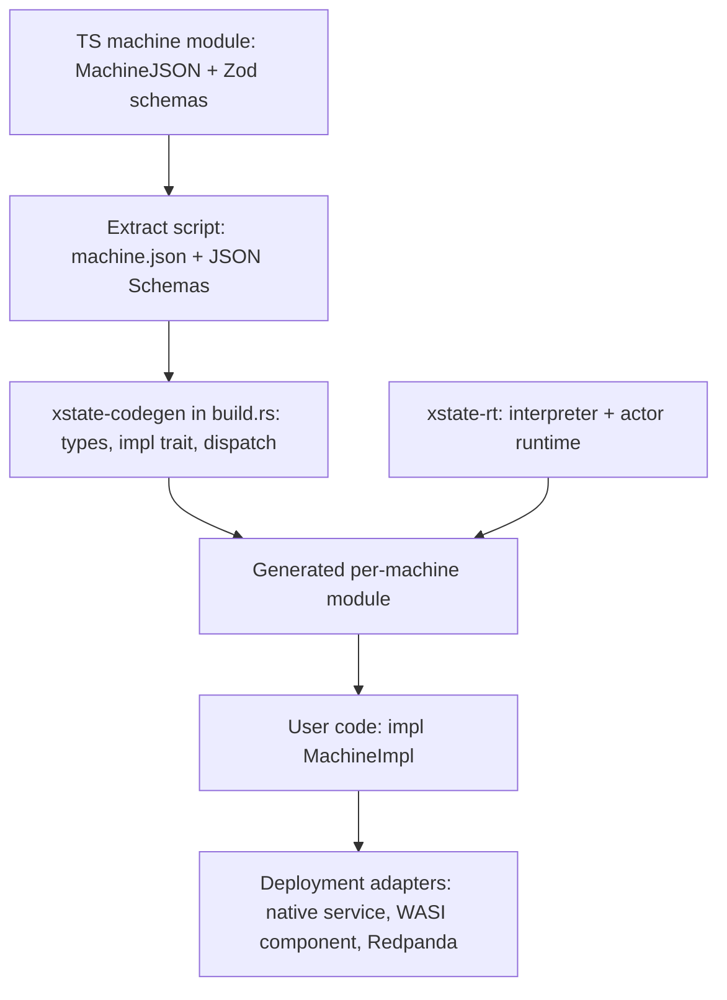

# xstate-rs

*Context for Claude Code. This repo is an independent Rust runtime that executes XState v6 machine definitions, with actions and guards written in Rust. It is not an official Stately package. Keep this file updated as decisions change.*

## Goal

Run full XState v6 statecharts and actor systems natively in Rust, with high performance and as close to a Redpanda broker as possible. Machines are authored in TypeScript (XState v6 alpha), exported as JSON, and executed by this runtime. Rust code supplies the implementations of named guards, actions, delays, and actors.

The two key requirements are semantic parity with XState v6 for the supported feature set, and a hot path with no JS engine, no string lookups, and no per-event allocation beyond what the semantics require.

## Background facts about XState v6

XState v6 is in alpha. **We pin `xstate@6.0.0-alpha.70`** (in `tools/differential/package.json`). APIs have changed between alphas; the package ships its docs in `node_modules/xstate/docs/*.md`, and those plus the runtime source (`dist/createActor-*.cjs.js`, `dist/xstate.cjs.js`) are the spec. The pages that matter most are serialization, transitions, how-xstate-runs-machines, delays, final-states, history-states, parallel-states and persistence.

Idiomatic v6 uses inline functions for transitions, guards, and actions, which serialize to `{"@code": "...", "@lang": "ts"}` (or `{"@expr": ...}`) and cannot run here. Machines that target this runtime must be written in the JSON-portable style: transitions as objects, with guards and actions referenced by name.

Verified against alpha.70:

- **Machine data format:** `machineToJSON(machine)` and `machineConfigToJSON(config)` produce `MachineJSON`. In JS, `machineFromJSON(json, sources)` revives it; that is our reference implementation for differential testing. (Older alphas called these `serializeMachine` / `createMachineFromConfig`.)
- **Transitions in JSON:** `{ target?, matches?, context?, actions?, guard?, reenter?, description?, meta?, input? }`, or an array of them (arrays are accepted by `machineFromJSON` only). String shorthand is rejected. `context` is a static shallow patch applied before `actions`. `matches` is a shallow pattern over the event payload, checked before the guard.
- **Guards in JSON:** `{ type, params? }`. A JSON-referenced guard receives the transition arguments first and `params` second. Built-ins: `@xstate.not` (`params.guard`) and `@xstate.stateIn` (`params.stateId`, with or without `#`). Root `guards: { name: { when: <guard> } }` defines named guards in JSON; JSON names win over provided sources.
- **Actions in JSON:** `@xstate.raise` (`event`, optional `id`, numeric `delay`), `@xstate.emit` (`event`), `@xstate.assign` (`context`, shallow merge), `@xstate.cancel` (`id`), `@xstate.log` (`args`). Any other `{ type, params }` is custom. Root `actions: { name: action | action[] }` defines named action lists in JSON. Names starting with `xstate.` / `@xstate.` are reserved.
- **Delays:** `after` keys are numbers (ms), named delays, or duration strings (`500ms`, `1.5s`, ISO 8601 such as `PT1M30S`). Root `delays: { name: number | string | { duration } }`.
- **Lifecycle events carry identity as payload** rather than in the type: `{ type: "xstate.done.state", stateId, output? }` and `{ type: "xstate.after", delay, stateId }` (`delay` is a number for numeric keys, the key string otherwise). `after` and `onDone` are sugar for transitions on these types with `matches` set. An unmatched done event bubbles like any other event.
- **`onDone` on states:** `machineToJSON` emits it, but `machineFromJSON` rejects it as an unknown key. We accept it and desugar it the way `createMachine` does (`xstate.done.state` with `matches: { stateId: <own id> }`).
- **Eventless transitions** use the `always` key.
- **Ids:** a state's id is its explicit `id`, else the key path joined by `.` and prefixed with the machine `id` if there is one (the root's id is the machine id, or `""`). `#id` targets match a whole id exactly.
- **Not representable in JSON yet:** state `input`, `enq.listen` / `enq.subscribeTo`, and `choice` functions. Reject these.
- **Schemas:** `schemas.context`, `schemas.events`, `input`, `output`, `emitted`, `children`, `schemas.actions`, `schemas.guards`. JSON `schemas` are descriptive only; runtime schemas are dropped by serialization, so they must be extracted at build time from the TS source.
- **Persistence:** v5 snapshots are not compatible with v6. We do not need byte-compatibility with JS snapshots unless decided otherwise.

## Architecture



Workspace crates (`xstate-rt`, `xstate-wasm` and `xstate-codegen` exist so far):

- `xstate-rt`: the core. `core.rs` is the structural statechart algorithm behind a `Host` trait; the native host (`interp.rs`) parses `MachineJSON`, compiles it, and runs it. Later also the actor runtime. Generic, with nothing machine-specific.
- `xstate-wasm`: exposes `core.rs` to JavaScript over a plain integer wasm ABI, so XState's own runtime can use it (see Testing strategy).
- `xstate-codegen`: build-time generator. Reads a `<name>.xstate.json` bundle (definition plus JSON Schemas) and emits typed Rust (context, events, params, the implementation trait, and the registry wiring).
- `xstate-wasi`: a WASI component adapter exposing the runtime through WIT.
- `xstate-redpanda`: the co-located, partition-sharded service.

Other directories: `fixtures/` (shared differential fixtures), `tools/differential/` (the JS side of differential testing), `tools/extract/` (the TS extract script), `examples/checkout/` (a machine authored in TS, run through codegen).

## Core runtime design (`xstate-rt`)

Module map: `core.rs` (the shared structural algorithm), `load.rs` (validation and compilation), `machine.rs` (compiled tree and values), `interp.rs` (the native host: values, effects, timers, macrostep), `system.rs` (the pure actor system: `Logic`, `System`, effects, timers, persistence), `step.rs` (step and async logic), `actor.rs` (the `Actor` convenience wrapper over a `System`), `registry.rs` (Rust implementations), `event.rs`, `delay.rs`, `error.rs`.

**Decision: internals are XState-true.** `core.rs` is a port of the structural half of XState's `stateUtils.ts` (`transitionNode`, `selectEventlessTransitions`, `removeConflictingTransitions`, `getTransitionDomain`, `computeExitSet`, `microstep`, `initialMicrostep`, the `macrostep` loop). Everything value-level goes through `Host` hooks, called at exactly the points and in exactly the order XState does that work (including its separate transition-result resolvers). Any host gets XState's behavior for free; the native host and XState's own JS (through `xstate-wasm`) both run on it, and XState's test suite is the conformance check. Changing `core.rs` means running that suite.

### Compilation

The interpreter never sees names on the hot path. At load time, the runtime does the following:

- Reject any `@code` or `@expr` node anywhere in the definition, reporting the JSON path. Reject unknown keys like `machineFromJSON` does. Fail loudly on unsupported features (`choice`, `route`, state and transition `input`, non-root `context`; invoke `input` is static JSON) instead of silently ignoring them.
- Build a flat arena of state nodes indexed in document (pre-order) order. Index order then equals document order, so entry order is ascending index and exit order is descending index. Each node stores `end` (one past its last descendant), so descendant checks are a range check.
- Resolve every target to node indices. Support `sibling.path` (relative to the source's parent), `.child` (relative to the source), and `#id`. `\.` escapes a dot inside a key.
- Resolve every guard, action, and named delay reference to an index. Registry entries are factories that take the reference's `params` and return a bound closure, so params are deserialized once at compile time. Missing implementations and bad params are load errors. Named JSON guards and actions are expanded inline (with cycle detection).
- Intern every event descriptor. Dispatching an event costs one hash lookup of its type; per-state candidates are then found by binary search. Wildcard descriptors are kept separately, longest first.
- Preserve object key order from JSON (`serde_json` with `preserve_order`). Transition priority depends on it.

The registry exposes typed helpers: `guard_with::<P>(name, |args, p: &P| ...)`, `action_with::<P>`, `delay(name, |ctx, ev| ms)`, `delay_ms`, and `actor(name, Arc<dyn Logic>)` for invoke sources.

### Events

User events are a generic `E: EventType` (`event_type()` is required; `field`, `to_json` and `from_json` default to serde), typically a generated serde enum with `#[serde(tag = "type")]`. `serde_json::Value` implements it for untyped use. Internally:

```rust
pub enum Ev<E> {
    Init,
    User(E),
    Internal { event_type: Cow<'static, str>, data: serde_json::Map<String, Value> },
}
```

A raised JSON event is deserialized into `E` when possible and falls back to `Internal`. Lifecycle events are `Internal` with a borrowed type, so they do not allocate the type string.

Event descriptor matching (verified): exact names, `prefix.*` (which also matches `prefix` itself), and `*`. Within a state, exact matches come first, then wildcards ordered by descriptor length, longest first.

### Interpreter

`core.rs` (structure) plus the native host (values), together a port of XState's `macrostep` / `microstep`:

- The configuration is an insertion-ordered set, exactly like XState's `snapshot.nodes`: exits remove, entries append, and a microstep that leaves membership and history unchanged keeps the old order. State values, parallel region order, and therefore selection and effect order follow it, so re-entering a region can move it after its siblings (verified; fixture `region_order`). A completed machine's node list is sorted in descending document order, as XState sorts it in place.

- Selection is XState's `transitionNode`: recurse into the active configuration; a node's own candidates are tried only if none of its active descendants selected a transition (for a parallel node, none of its regions). Final states are inert. Then conflicting transitions are removed (a descendant source preempts its ancestor when exit sets intersect).
- Transition domain: as XState's `getTransitionDomain`. Targetless transitions exit and enter nothing. If all effective targets are the source or its descendants, the domain is the source (with `reenter`) or the source narrowed past parallel states. Otherwise it is the least common ancestor, again narrowed past parallel states unless `reenter`, so a transition confined to one region never exits sibling regions. A non-reentering self-target on a compound state exits and re-enters its children (back to `initial`).
- Exit: record history (shallow means active children, deep means active atomic descendants), cancel the state's `after` timers, run exit actions, remove from the configuration. Delayed raises are not cancelled on exit.
- Then transition content: the `context` patch, then `actions`.
- Entry: compute the entry set (targets, initial descendants, all regions of parallel states, history defaults or recorded values, ancestors inside the domain), enter in document order, run entry actions, then schedule `after` timers. Entering a final state queues `xstate.done.state` for its compound parent with its `output`; completing parallel ancestors queue their own done events with an output object keyed by region. A final child of the root sets status `done` and the output (root `output` if declared, else the final state's `output`); then every active state's exit actions run and all timers are cleared. The configuration is kept so the final value remains visible.
- Macrostep: microstep for the external event, then loop: select eventless transitions; if none, take the next internal event. Eventless transitions are re-selected only when the last eventless microstep produced a new snapshot object (XState's `nextSnapshot !== previousState`); the native host tracks that with a token bumped whenever XState would clone the snapshot (context written, timers changed, structure or status changed). More than `max_iterations` (default 1000) microsteps is `SystemError::InfiniteLoop` and the actor goes to `error`.
- **Effect model (decision: mirror v6 exactly).** A transition's result (its `context` patch, then its actions as `machineFromJSON`'s `executeActions`) is computed against the snapshot at the start of the microstep and merged after exits, as XState's transition functions are; an action list with `@xstate.assign` yields the full context at that point plus the patches, which can overwrite exit-action changes, as in XState. `@xstate.raise` without delay goes to the internal queue; delayed raises and cancels update the snapshot's logical timers during resolution; emits, logs and custom actions are effects executed after the macrostep, in order. Custom Rust actions receive only their params (`Registry::action_with`) and cannot touch context; context changes only via `@xstate.assign` and transition `context`. The earlier `&mut C` extension is gone.

### Time and scheduling

The runtime never reads a clock or sleeps. The host drives time:

```rust
actor.send(event, now_ms);   // fires timers due by now_ms, then sends
actor.next_deadline();       // Option<u64>
actor.advance(now_ms);       // fires due timers in (due, seq) order
```

Timers live in the system, keyed like XState's `systemTimerKey`. They come from `after`, state `timeout` and invoke `timeout` (cancelled on exit, in reverse of their scheduling order) and from delayed `@xstate.raise` (by `id`, or by a per-actor sequence number when there is no id). Scheduling a timer whose key is already pending replaces it. While firing a timer, the actor's clock is its due time, so nested delays are deterministic (verified against XState's `SimulatedClock`). A fired timer's event is processed as an internal event. Numeric `after` keys are milliseconds; fractional values round up.

This keeps the core deterministic and portable to WASI and Wasm (`xstate-rt` builds for `wasm32-unknown-unknown`). Never call `std::time::Instant::now()`.

### Snapshots and persistence

Persistence is XState's `SystemSnapshot` JSON (`System::to_json` / `System::from_json`, `Actor::persist` / `Actor::restore`): every actor by address with its incarnation, parent, logic, input, started flag and snapshot data, plus the registry, queued messages, timers, pending external effects, counters and the clock. A machine's snapshot data is XState's (`status`, `context`, `value`, `children` as `{ $actor, incarnation }`, `timers`, `historyValue` as `{ $stateNode }`, `nodeIds`, `_nextTimerId`). XState's own snapshot data restores into an equal Rust system (checked on every system fixture record). Restoring runs no actions. Binary encodings (postcard, rkyv) need a non-self-describing replacement for the `serde_json::Value` fields; decide that in milestone 6.

### Actor system (milestone 2)

**Decision: port XState's pure system API** (`initialSystemTransition`, `systemTransition`, `advanceSystemTime` in `systemTransition.ts`) rather than a live actor runtime. `System` is a value: one call takes an event (or a time, or an effect result) and returns the external effects it produced, with no executor, threads or clock. Single-threaded per shard, no locks.

- `Logic` is XState's actor logic: `initial_transition`, `transition` (returns `Effect`s: spawn, start, stop, cancel, delayed raise, send-to, terminate, external), `snapshot_data` / `restore`. `Machine<C, E>` and `StepLogic` (`step.rs`, including `async_logic`) implement it. Snapshots are `Box<dyn AnySnapshot>`; events cross actors as `serde_json::Value` and become `E` at the receiving machine.
- Actors are addressed by path (`root/child`), with incarnation counters so stale references and effect results are rejected. Messages are FIFO; starts are deferred to the end of the sending macrostep, as in XState. `systemId` registry with conflict errors; stopping cascades to children and unregisters.
- Invoke: default id `<stateId>:<index>`; `onDone` / `onError` / `onSnapshot` are transitions on `xstate.done.actor` / `xstate.error.actor` / `xstate.snapshot.actor` with `matches { actorId }` plus the current session. Invoke `timeout` raises `xstate.timeout.actor`; completion transitions cancel it. State-level `onError` catches `xstate.error.*`; an unhandled child error puts the parent in `error`.
- External effects (emits, logs, custom actions, `@xstate.effect` async work, cancellations, cleanup) get ids `system:N` and stay pending until acknowledged or resolved (`xstate.system.effect.result`). `Actor` runs custom actions and collects the root's emits and logs automatically; async work waits for `Actor::resolve_effect`.
- Known XState bug (alpha.70): `onSnapshot` on an invoked machine with recorded history throws in `SystemReduction.decode` (decoded without its machine). We do not reproduce the crash; no fixture covers that combination.

## Codegen (milestone 3)

Every machine that targets Rust provides Zod schemas, including `schemas.actions` and `schemas.guards` for params. The pipeline (example: `examples/checkout`):

1. **Author** a TS module exporting `machine` (a `MachineJSON` value; `createMachine` rejects object-form guards in v6, so JSON-portable machines are written as data) and `schemas` (`context`, `input`, `output`, `events`, `internalEvents`, `emitted`, `actions: { name: { params? } }`, `guards: { name: { params? } }`; other keys are errors).
2. **Extract:** `node tools/extract/extract.mjs <module.ts>` (Node 22 strips the types; `zod` and `xstate` resolve to the tool's pinned copies) converts the schemas with `z.toJSONSchema` (output mode, unrepresentable types throw), rejects `@code` / `@expr`, adds `internalEvents` from the schema, validates the definition with XState's own `machineFromJSON` (stub sources added for each "Missing ... source" it reports), and writes `<module>.xstate.json` = `{ machine, schemas }`. Commit the bundle; `--check` fails when it is stale.
3. **Generate:** `xstate_codegen::Builder::new().machine("…/checkout.xstate.json").build()` in `build.rs` writes `$OUT_DIR/xstate/checkout.rs`; `xstate_rt::include_machine!("checkout")` includes it in a module. Before emitting, it lints: the definition must load (`Machine::references`, the runtime's own resolution, which lists every guard, action, delay and actor the host must supply with JSON paths and params); every referenced guard and action needs a `schemas.guards` / `schemas.actions` entry and its params must validate; handled (`on` keys other than wildcards and `xstate.*`), raised and emitted event types must be declared and static payloads validate; the initial context, transition `context` and `@xstate.assign` patches, and the root output (or root final states' outputs) validate. Unused schema entries are `cargo:warning`s.
4. **Emitted module:** `Context`, `Event` (serde enum tagged by `type`, public and internal events, `EventType::event_type` is a `match`), `Emitted`, `Input`, `Output`, `<Name>Params`; trait `<MachineId>Impl` with `guard_*(&self, &GuardArgs<Context, Event>[, &Params]) -> bool`, `action_*(&self[, &Params])`, `delay_*(&self, &Context, &Ev<Event>) -> u64` (only for delays not defined in JSON; delays and actors have fixed signatures, so they need no schema entry), `actor_*(&self) -> Arc<dyn Logic>`; `registry(Arc<impl>)`, `machine(Arc<impl>)`, `ID`, `DEFINITION`, `type Actor`. Generated code refers to `xstate_rt::__codegen` (serde, serde_json, IndexMap re-exports), so user crates depend only on `xstate-rt`.

Mapping rules (custom generator in `crates/xstate-codegen/src/types.rs`, no typify): `number` is `f64`, `integer` (`.int()`) is `i64`, `boolean` is `bool`, `string` is `String`; string `enum` / `const` become unit enums; optional properties are `Option<T>` with `skip_serializing_if` (an optional nullable field is a single `Option`, so `null` and absent are not distinguished); `T | null` is `Option<T>`; arrays are `Vec`, `prefixItems` tuples; records are `IndexMap<String, T>`; objects with properties are structs (snake_case fields with `rename`, keywords as raw identifiers, `description` as docs, `default` via a generated serde default); discriminated unions (`oneOf`/`anyOf` of objects sharing a required string `const` key) are internally tagged enums; `{}` / `unknown` is `serde_json::Value`. Types are named by path (`Context` + `Lines` + `Item`); `.meta({ id })` names a shared type once; recursive references are boxed. Rejected with the schema path: `allOf` (intersections), untagged unions, non-string enums and literals, `not` / `if` / `patternProperties`. Branded types are type-only in Zod 4 and cannot be detected; they erase to their base type.

**Decision: numbers are written as JavaScript writes them.** A Rust `f64` holding `1.0` serializes as `1.0`, which JS writes as `1` (and `serde_json` compares unequal to `1`). The runtime normalizes whole-number floats to integers (`xstate_rt::js_numbers`) wherever typed values become JSON: event `to_json` / `field` defaults, context merges and snapshot data. `matches` already compares numbers numerically.

## Deployment targets

- **WASI component:** a sync, host-driven core works on WASI 0.2 and 0.3. Export a WIT `actor` resource with `send`, `snapshot`, `persist`, `restore`, `next-deadline`, `advance`, and `take-emitted`, passing JSON strings. Target `wasm32-wasip2` with `wit-bindgen`. Adopt WASI 0.3 async for host-provided invoked actors once Rust guest tooling stabilizes.
- **Redpanda (performance target):** a native Rust service co-located on each broker node, not in-broker Data Transforms, which have no network or disk access and only support single-record transforms. Use follower fetching (`enable_rack_awareness`, per-node `rack`, `client.rack`) to read the local replica. Shard by partition with one thread per core. Keep actors in memory, back them with a compacted changelog topic per machine (binary snapshots via postcard or rkyv) plus a local embedded store, and use Kafka transactions to commit emitted events, changelog writes, and offsets atomically in batches. Persist timer firings through the changelog in the same transaction. Use `rdkafka`.

## Testing strategy

**XState's own test suite runs on the Rust core.** `tools/xstate-suite/run.sh` clones `xstate@6.0.0-alpha.70`, applies `xstate-core.patch` (to `stateUtils.ts` and `StateMachine.ts`) and installs `rustBridge.ts`, builds `xstate-wasm`, and runs `packages/core/test` with vitest. With `XSTATE_RS_WASM` set, selection, `selectEventlessTransitions`, `microstep`, `initialMicrostep` and the macrostep loop run in Rust; the patch's `RsHost` class is XState's original microstep code split into the `Host` hooks. `XSTATE_RS=0 tools/xstate-suite/run.sh` runs the unpatched algorithm for comparison. Pass `--reporter=dot` or a file filter as extra arguments. To change the patch: edit `tools/xstate-suite/.xstate/packages/core/src`, then `git -C tools/xstate-suite/.xstate diff -- packages/core/src > tools/xstate-suite/xstate-core.patch`.

The wasm ABI: hooks are `xs.*` imports returning `-1` when JS threw (the exception is stashed and rethrown after Rust unwinds); arrays go to JS as pointers into wasm memory and come back through fixed exchange buffers; calls may re-enter (a guard can run another actor), so hosts form a stack and buffers are read immediately.

Development warnings XState logs while matching wildcard descriptors are produced by the Rust matcher with the same text and order, on the first candidate lookup per node and event type (mirroring `StateNode._candidateCache`).

Native differential testing:

- `fixtures/<name>.json` holds `{ machine, steps }`, where each step is `{ at, send? }`: advance the clock to `at` (firing due timers), then send `send`.
- `tools/differential/generate.mjs` runs each fixture through `machineFromJSON` with stub guards (`yes`, `no`, `ctxEquals`, `ctxAtLeast`, `eventEquals`), a `noop` action and delays `short`/`long`, and writes `<name>.expected.json`: value, context, status, output and emitted events after start and after every step. Regenerate with `cd tools/differential && npm install && npm run generate` (or `node generate.mjs <name>`).
- `crates/xstate-rt/tests/differential.rs` replays the same fixtures with equivalent Rust stubs and diffs every record. Commit the expected files; they are the record of XState's behavior.
- `@xstate.emit` in entry/exit/transition actions is the way to observe action order in fixtures.

System-level differential testing: `fixtures/system/<name>.json` lists logic (machines with their actors, or `async` logic), the root, init options, and steps (`send` to an address, `advance` to a time, `resolve` the n-th pending effect in id order). `tools/differential/generate-system.mjs` runs them through XState's pure system API and records the full system snapshot and effects (or the error) per step; `crates/xstate-rt/tests/system_differential.rs` replays them, compares (object key order ignored except in state values), restores XState's snapshot into Rust and compares again, and checks that a failing call leaves the snapshot unchanged. Regenerate with `node generate-system.mjs [name]` (`STACK=1` prints XState's stack for error records).

`crates/xstate-rt/tests/runtime.rs` covers what the JS side cannot: typed context and events, Rust actions with params, registry delays, load errors with paths, runaway loops, persist/restore round-trips including pending timers and history, `onDone`, `internalEvents`, and `stop`.

When v6 behavior is uncertain, add a fixture before choosing semantics.

## Milestones

1. ~~`xstate-rt` core: parsing, validation, compilation, interpreter, built-in actions, registry, host-driven timers, persist and restore, unit tests.~~ Done, with the differential harness (originally milestone 4) started early. ~~XState-true core shared with XState's JS runtime; XState's core test suite passes on it.~~
2. ~~Actor runtime: invoke, system, done and error propagation, timeouts.~~ Done as a port of XState's pure system API, with system differential fixtures. Still open: `spawn` / `sendTo` from JSON actions (no JSON-portable form in alpha.70), listeners and subscriptions.
3. ~~Codegen pipeline and the TS extract script.~~ Done (`tools/extract`, `xstate-codegen`, `examples/checkout`). Open: typed `ActorRef<Child>` handles from `schemas.children`.
4. Differential test harness: ~~extend fixtures to actors~~; add generated random event sequences.
5. WASI component adapter.
6. Redpanda co-located service with benchmarks.

## Conventions

- Prefer clarity over cleverness in the interpreter; correctness against XState comes first, then optimize with benchmarks. Known costs to revisit: candidate lookup scans descriptor strings per node (intern them), per-microstep `Vec`/`OrderedSet` allocations, `Host::config()` cloning the configuration, context merges through `serde_json::Value`, and `Ev::Internal` payload maps for lifecycle events.
- No `unsafe` in `xstate-rt`. No platform clocks, threads, or I/O in the core.
- Every unsupported v6 feature produces a clear error naming the feature and its JSON path.
- When v6 behavior is uncertain, write a differential test before choosing semantics, and record the decision in this file.
- `cargo fmt`, `cargo clippy --all-targets` clean, `cargo test` green before pushing; after touching `core.rs`, also `tools/xstate-suite/run.sh`.
