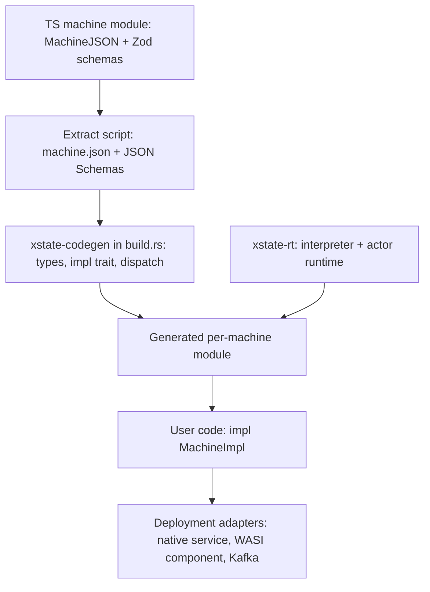

# xstate-rs

*Context for Claude Code. This repo is an independent Rust runtime that executes XState v6 machine definitions, with actions and guards written in Rust. It is not an official Stately package. Keep this file updated as decisions change.*

## Goal

Run full XState v6 statecharts and actor systems natively in Rust, with high performance and as close to the Kafka broker as possible. Machines are authored in TypeScript (XState v6 alpha), exported as JSON, and executed by this runtime. Rust code supplies the implementations of named guards, actions, delays, and actors.

The two key requirements are semantic parity with XState v6 for the supported feature set, and a hot path with no JS engine, no string lookups, and no per-event allocation beyond what the semantics require.

## Background facts about XState v6

XState v6 is in alpha. **We pin `xstate@6.0.0-alpha.70`** (in `tools/differential/package.json`). APIs have changed between alphas; the package ships its docs in `node_modules/xstate/docs/*.md`, and those plus the runtime source (`dist/createActor-*.cjs.js`, `dist/xstate.cjs.js`) are the spec. The pages that matter most are serialization, transitions, how-xstate-runs-machines, delays, final-states, history-states, parallel-states and persistence.

Idiomatic v6 uses inline functions for transitions, guards, and actions, which serialize to `{"@code": "...", "@lang": "ts"}` (or `{"@expr": ...}`) and cannot run here. Machines that target this runtime must be written in the JSON-portable style: transitions as objects, with guards and actions referenced by name.

Verified against alpha.70:

- **Machine data format:** `machineToJSON(machine)` and `machineConfigToJSON(config)` produce `MachineJSON`. In JS, `machineFromJSON(json, sources)` revives it; that is our reference implementation for differential testing. (Older alphas called these `serializeMachine` / `createMachineFromConfig`.)
- **Transitions in JSON:** `{ target?, matches?, context?, actions?, guard?, reenter?, description?, meta?, input? }`, or an array of them (arrays are accepted by `machineFromJSON` only). String shorthand is rejected. `context` is a static shallow patch applied before `actions`. `matches` is a shallow pattern over the event payload, checked before the guard.
- **Guards in JSON:** `{ type, params? }`. A JSON-referenced guard receives the transition arguments first and `params` second. Built-ins: `@xstate.not` (`params.guard`) and `@xstate.stateIn` (`params.stateId`, with or without `#`). Root `guards: { name: { when: <guard> } }` defines named guards in JSON; JSON names win over provided sources.
- **Actions in JSON:** `@xstate.raise` (`event`, optional `id`, numeric `delay`), `@xstate.emit` (`event`), `@xstate.assign` (`context`, shallow merge), `@xstate.cancel` (`id`), `@xstate.log` (`args`). Any other `{ type, params }` is custom. Root `actions: { name: action | action[] }` defines named action lists in JSON. Names starting with `xstate.` / `@xstate.` are reserved.
- **Delays:** `after` keys are numbers (ms), named delays, or duration strings (`500ms`, `1.5s`, ISO 8601 such as `PT1M30S`). Root `delays: { name: number | string | { duration } }`.
- **Lifecycle events carry identity as payload** rather than in the type: `{ type: "xstate.done.state", stateId, output? }` and `{ type: "xstate.after", delay, stateId }` (`delay` is a number for numeric keys, the key string otherwise). `after` and `onDone` are sugar for transitions on these types with `matches` set. An unmatched done event bubbles like any other event.
- **`onDone` on states:** `machineToJSON` emits it, but `machineFromJSON` rejects it as an unknown key. We accept it and desugar it the way `createMachine` does (`xstate.done.state` with `matches: { stateId: <own id> }`).
- **Eventless transitions** use the `always` key.
- **Ids:** a state's id is its explicit `id`, else the key path joined by `.` and prefixed with the machine `id` if there is one (the root's id is the machine id, or `""`). `#id` targets match a whole id exactly.
- **Not representable in JSON yet:** state `input`, `enq.listen` / `enq.subscribeTo`, and `choice` functions. Reject these.
- **Schemas:** `schemas.context`, `schemas.events`, `input`, `output`, `emitted`, `children`, `schemas.actions`, `schemas.guards`. JSON `schemas` are descriptive only; runtime schemas are dropped by serialization, so they must be extracted at build time from the TS source.
- **Persistence:** v5 snapshots are not compatible with v6. We do not need byte-compatibility with JS snapshots unless decided otherwise.

## Architecture



Workspace crates:

- `xstate-rt`: the core. `core.rs` is the structural statechart algorithm behind a `Host` trait; the native host (`interp.rs`) parses `MachineJSON`, compiles it, and runs it. Later also the actor runtime. Generic, with nothing machine-specific.
- `xstate-wasm`: exposes `core.rs` to JavaScript over a plain integer wasm ABI, so XState's own runtime can use it (see Testing strategy).
- `xstate-codegen`: build-time generator. Reads a `<name>.xstate.json` bundle (definition plus JSON Schemas) and emits typed Rust (context, events, params, the implementation trait, and the registry wiring).
- `xstate-wasi`: a WASI 0.2 component (`wasm32-wasip2`) exposing the runtime through WIT; `xstate-wasi-host` (not a default member, it builds Wasmtime) tests it.
- `xstate-kafka`: the co-located, partition-sharded service: a deterministic engine (`engine.rs`, no Kafka) and, with the `kafka` feature, the `rdkafka` driver (`service.rs`).

Other directories: `fixtures/` (shared differential fixtures), `tools/differential/` (the JS side of differential testing), `tools/extract/` (the TS extract script), `examples/checkout/` (a machine authored in TS, run through codegen).

## Core runtime design (`xstate-rt`)

Module map: `core.rs` (the shared structural algorithm), `load.rs` (validation and compilation), `machine.rs` (compiled tree and values), `interp.rs` (the native host: values, effects, timers, macrostep), `system.rs` (the pure actor system: `Logic`, `System`, effects, timers, persistence), `step.rs` (step and async logic), `actor.rs` (the `Actor` convenience wrapper over a `System`), `registry.rs` (Rust implementations), `event.rs`, `delay.rs`, `error.rs`.

**Decision: internals are XState-true.** `core.rs` is a port of the structural half of XState's `stateUtils.ts` (`transitionNode`, `selectEventlessTransitions`, `removeConflictingTransitions`, `getTransitionDomain`, `computeExitSet`, `microstep`, `initialMicrostep`, the `macrostep` loop). Everything value-level goes through `Host` hooks, called at exactly the points and in exactly the order XState does that work (including its separate transition-result resolvers). Any host gets XState's behavior for free; the native host and XState's own JS (through `xstate-wasm`) both run on it, and XState's test suite is the conformance check. Changing `core.rs` means running that suite.

### Compilation

The interpreter never sees names on the hot path. At load time, the runtime does the following:

- Reject any `@code` or `@expr` node anywhere in the definition, reporting the JSON path. Reject unknown keys like `machineFromJSON` does. Fail loudly on unsupported features (`choice`, state, transition and route `input`, non-root `context`; invoke `input` is static JSON) instead of silently ignoring them.
- Route states (as XState's `formatRouteTransitions`): every state with an explicit `id` and a truthy `route` (`{}`, `true`, or an object with `context`, `reenter`, `meta`, `description`, and `guard`, the name of a guard) adds, in document order, a transition on the root under `xstate.route` (replacing the root's own) to `#id`, enabled when the event's `to` is exactly `#id` and the named guard passes. The source being the root means routing exits and re-enters up to the root's narrowed domain (fixture `routes`: routing into one region of a parallel child of a compound root resets the other regions).
- Build a flat arena of state nodes indexed in document (pre-order) order. Index order then equals document order, so entry order is ascending index and exit order is descending index. Each node stores `end` (one past its last descendant), so descendant checks are a range check.
- Resolve every target to node indices. Support `sibling.path` (relative to the source's parent), `.child` (relative to the source), and `#id`. `\.` escapes a dot inside a key.
- Resolve every guard, action, and named delay reference to an index. Registry entries are factories that take the reference's `params` and return a bound closure, so params are deserialized once at compile time. Missing implementations and bad params are load errors. Named JSON guards and actions are expanded inline (with cycle detection).
- Intern every event descriptor. Dispatching an event costs one hash lookup of its type; per-state candidates are then found by binary search. Wildcard descriptors are kept separately, longest first.
- Preserve object key order from JSON (`serde_json` with `preserve_order`). Transition priority depends on it.

The registry exposes typed helpers: `guard_with::<P>(name, |args, p: &P| ...)`, `action_with::<P>`, `delay(name, |ctx, ev| ms)`, `delay_ms`, and `actor(name, Arc<dyn Logic>)` for invoke sources.

### Events

User events are a generic `E: EventType` (`event_type()` is required; `field`, `to_json` and `from_json` default to serde), typically a generated serde enum with `#[serde(tag = "type")]`. `serde_json::Value` implements it for untyped use. Internally:

```rust
pub enum Ev<E> {
    Init,
    User(E),
    Internal { event_type: Cow<'static, str>, data: serde_json::Map<String, Value> },
}
```

A raised JSON event is deserialized into `E` when possible and falls back to `Internal`. Lifecycle events are `Internal` with a borrowed type, so they do not allocate the type string.

Event descriptor matching (verified): exact names, `prefix.*` (which also matches `prefix` itself), and `*`. Within a state, exact matches come first, then wildcards ordered by descriptor length, longest first.

### Interpreter

`core.rs` (structure) plus the native host (values), together a port of XState's `macrostep` / `microstep`:

- The configuration is an insertion-ordered set, exactly like XState's `snapshot.nodes`: exits remove, entries append, and a microstep that leaves membership and history unchanged keeps the old order. State values, parallel region order, and therefore selection and effect order follow it, so re-entering a region can move it after its siblings (verified; fixture `region_order`). A completed machine's node list is sorted in descending document order, as XState sorts it in place.

- Selection is XState's `transitionNode`: recurse into the active configuration; a node's own candidates are tried only if none of its active descendants selected a transition (for a parallel node, none of its regions). Final states are inert. Then conflicting transitions are removed (a descendant source preempts its ancestor when exit sets intersect).
- Transition domain: as XState's `getTransitionDomain`. Targetless transitions exit and enter nothing. If all effective targets are the source or its descendants, the domain is the source (with `reenter`) or the source narrowed past parallel states. Otherwise it is the least common ancestor, again narrowed past parallel states unless `reenter`, so a transition confined to one region never exits sibling regions. A non-reentering self-target on a compound state exits and re-enters its children (back to `initial`).
- Exit: record history (shallow means active children, deep means active atomic descendants), cancel the state's `after` timers, run exit actions, remove from the configuration. Delayed raises are not cancelled on exit.
- Then transition content: the `context` patch, then `actions`.
- Entry: compute the entry set (targets, initial descendants, all regions of parallel states, history defaults or recorded values, ancestors inside the domain), enter in document order, run entry actions, then schedule `after` timers. Entering a final state queues `xstate.done.state` for its compound parent with its `output`; completing parallel ancestors queue their own done events with an output object keyed by region. A final child of the root sets status `done` and the output (root `output` if declared, else the final state's `output`); then every active state's exit actions run and all timers are cleared. The configuration is kept so the final value remains visible.
- Macrostep: microstep for the external event, then loop: select eventless transitions; if none, take the next internal event. Eventless transitions are re-selected only when the last eventless microstep produced a new snapshot object (XState's `nextSnapshot !== previousState`); the native host tracks that with a token bumped whenever XState would clone the snapshot (context written, timers changed, structure or status changed). More than `max_iterations` (default 1000) microsteps is `SystemError::InfiniteLoop` and the actor goes to `error`.
- **Effect model (decision: mirror v6 exactly).** A transition's result (its `context` patch, then its actions as `machineFromJSON`'s `executeActions`) is computed against the snapshot at the start of the microstep and merged after exits, as XState's transition functions are; an action list with `@xstate.assign` yields the full context at that point plus the patches, which can overwrite exit-action changes, as in XState. `@xstate.raise` without delay goes to the internal queue; delayed raises and cancels update the snapshot's logical timers during resolution; emits, logs and custom actions are effects executed after the macrostep, in order. Custom Rust actions receive only their params (`Registry::action_with`) and cannot touch context; context changes only via `@xstate.assign` and transition `context`. The earlier `&mut C` extension is gone.

### Time and scheduling

The runtime never reads a clock or sleeps. The host drives time:

```rust
actor.send(event, now_ms);   // when time moved forward, fires timers due by now_ms first
actor.next_deadline();       // Option<u64>
actor.advance(now_ms);       // fires due timers in (due, seq) order, each as its own step
```

`Actor` follows XState's live actor; `System` is XState's pure system API, whose calls (`systemTransition`) first fire every timer due at the current time. The two differ only for zero-delay timers: a live actor with a `SimulatedClock` fires them when the clock next moves. `Actor::advance` fires one timer occurrence per step (`System::fire_next_timer`), so when a later timer fails, the effects of earlier ones have already run, as in a live actor.

Timers live in the system, keyed like XState's `systemTimerKey`. They come from `after`, state `timeout` and invoke `timeout` (cancelled on exit, in reverse of their scheduling order) and from delayed `@xstate.raise` (by `id`, or by a per-actor sequence number when there is no id). Scheduling a timer whose key is already pending replaces it. While firing a timer, the actor's clock is its due time, so nested delays are deterministic (verified against XState's `SimulatedClock`). A fired timer's event is processed as an internal event. Numeric `after` keys are milliseconds; fractional values round up.

This keeps the core deterministic and portable to WASI and Wasm (`xstate-rt` builds for `wasm32-unknown-unknown`). Never call `std::time::Instant::now()`.

### Snapshots and persistence

Persistence is XState's `SystemSnapshot` JSON (`System::to_json` / `System::from_json`, `Actor::persist` / `Actor::restore`): every actor by address with its incarnation, parent, logic, input, started flag and snapshot data, plus the registry, queued messages, timers, pending external effects, counters and the clock. A machine's snapshot data is XState's (`status`, `context`, `value`, `children` as `{ $actor, incarnation }`, `timers`, `historyValue` as `{ $stateNode }`, `nodeIds`, `_nextTimerId`). XState's own snapshot data restores into an equal Rust system (checked on every system fixture record). Restoring runs no actions. **Decision (milestone 6): changelog snapshots are MessagePack** (`rmp-serde`, self-describing, so `serde_json::Value` fields need no replacement), behind a format byte (`Codec`), so JSON records stay readable and the encoding can change. Measured on a small order actor: 617 bytes and 7.4 µs to decode versus 822 bytes and 8.6 µs for JSON. **Decision: changelog snapshots are XState's own `SystemSnapshot` by default; a compact form is an opt-in optimization** (`SnapshotFormat::XState` / `Compact`, config `"snapshots": "xstate" | "compact"`): `System::compact_view` / `Actor::persist_compact` write XState's `SystemSnapshot` without what restore rebuilds identically (empty collections, the default execution id, actor addresses (the keys of `actors`), and in machine snapshots the state `value` (derived from `nodeIds`), empty `children`, `historyValue`, `timers`, `_stateInputs` and a zero `_nextTimerId`). No marker is needed: restore reads both forms the same way. The differential tests restore every record's compact snapshot and require the same `to_json`. Compact snapshots are not meant for XState's own restore; choose `"compact"` only when this service alone reads the changelog. MessagePack is written by a dedicated writer (`xstate-kafka/src/msgpack.rs`, byte-identical to `rmp_serde`'s named encoding, tested) because `rmp_serde`'s general writer cost several times the encoding; it falls back to `rmp_serde` for data of unknown length. A small order actor: 484 bytes and about 1.1 µs per snapshot (617 bytes and 3.8 µs before). Decoding on restore (about 7.5 µs) still goes through `Value`. **Decision: protobuf is an opt-in codec** (`Codec::Protobuf`, format byte 3, config `"codec": "protobuf"`), always of the compact form: `xstate-kafka/src/proto` has a hand-written wire format (no generated code, no `protoc`), a generic JSON `Value` message (`value.rs`), and a serde serializer guided by static message tables (`snapshot.rs`) over the same `SystemView`, so free-form data (context, events, outputs) becomes `Value` messages and keys or shapes a message does not describe go to field 100 (`extra`), which also keeps empty collections. `proto/xstate_snapshot.proto` (package `xstate.snapshot.v1`) is generated and checked in; a unit test fails when it is stale (`XSTATE_WRITE_PROTO=1 cargo test -p xstate-kafka --lib` rewrites it), and `tests/proto.rs` round-trips all 415 recorded XState snapshots and reads records with prost as an independent decoder. Small order actor: 248 bytes and about 1.9 µs to encode, 5.1 µs to decode (MessagePack compact: 484 bytes, 1.2 µs, 4.5 µs); the encode gap is the serde layers, so direct encoding from runtime state is the follow-up if it matters. With batch compression the size gap narrows.

### Actor system (milestone 2)

**Decision: port XState's pure system API** (`initialSystemTransition`, `systemTransition`, `advanceSystemTime` in `systemTransition.ts`) rather than a live actor runtime. `System` is a value: one call takes an event (or a time, or an effect result) and returns the external effects it produced, with no executor, threads or clock. Single-threaded per shard, no locks.

- `Logic` is XState's actor logic: `initial_transition`, `transition` (returns `Effect`s: spawn, start, stop, cancel, delayed raise, send-to, terminate, external), `snapshot_data` / `restore`. `Machine<C, E>` and `StepLogic` (`step.rs`, including `async_logic`) implement it. Snapshots are `Box<dyn AnySnapshot>`; events cross actors as `serde_json::Value` and become `E` at the receiving machine.
- Actors are addressed by path (`root/child`), with incarnation counters so stale references and effect results are rejected. Messages are FIFO; starts are deferred to the end of the sending macrostep, as in XState. `systemId` registry with conflict errors; stopping cascades to children and unregisters.
- Invoke: default id `<stateId>:<index>`; `onDone` / `onError` / `onSnapshot` are transitions on `xstate.done.actor` / `xstate.error.actor` / `xstate.snapshot.actor` with `matches { actorId }` plus the current session. Invoke `timeout` raises `xstate.timeout.actor`; completion transitions cancel it. State-level `onError` catches `xstate.error.*`; an unhandled child error puts the parent in `error`.
- External effects (emits, logs, custom actions, `@xstate.effect` async work, cancellations, cleanup) get ids `system:N` and stay pending until acknowledged or resolved (`xstate.system.effect.result`). `Actor` runs custom actions and collects the root's emits and logs automatically; async work waits for `Actor::resolve_effect`.
- Known XState bug (alpha.70): `onSnapshot` on an invoked machine with recorded history throws in `SystemReduction.decode` (decoded without its machine). We do not reproduce the crash; no fixture covers that combination, and `fuzz-system.mjs` drops cases that hit it.
- **Decision: a failed macrostep keeps the previous snapshot.** When a machine's macrostep fails (`InfiniteLoop`), the actor keeps its snapshot from before the event with status `error` and the error, and the step's effects are discarded, as XState's live actor (`_setErrorSnapshot`). The native host clones the state at the start of each macrostep to restore it (a known cost). XState can show context written by entry actions of the failed step (it assigns `nextState.context` on a snapshot it has not cloned yet); that aliasing bug is not reproduced, and the differential tests skip context in error records. A failing initial transition fails `Actor::start` (XState starts an actor whose snapshot is `{ status: 'error' }` with no value), including a root `initial` without child states, which XState loads and fails on at start.
- **Illegal configurations follow XState.** XState can reach configurations that are not legal (two targets in different regions where one leaves the parallel state: fixture `conflicting_regions`). Its state value and transition selection are built from `getAllStateNodes(nodes)` (ancestors and default descendants added), and `transitionNode` walks every key of an object value even under a compound state. `core::all_state_nodes` and `transition_node` do the same, so behavior on such configurations matches too. Restore accepts them as well (it rejects only unknown ids, duplicates and active history states).

## Codegen (milestone 3)

Every machine that targets Rust provides Zod schemas, including `schemas.actions` and `schemas.guards` for params. The pipeline (example: `examples/checkout`):

1. **Author** a TS module exporting `machine` (a `MachineJSON` value; `createMachine` rejects object-form guards in v6, so JSON-portable machines are written as data) and `schemas` (`context`, `input`, `output`, `events`, `internalEvents`, `emitted`, `actions: { name: { params? } }`, `guards: { name: { params? } }`; other keys are errors).
2. **Extract:** `node tools/extract/extract.mjs <module.ts>` (Node 22 strips the types; `zod` and `xstate` resolve to the tool's pinned copies) converts the schemas with `z.toJSONSchema` (output mode, unrepresentable types throw), rejects `@code` / `@expr`, adds `internalEvents` from the schema, validates the definition with XState's own `machineFromJSON` (stub sources added for each "Missing ... source" it reports), and writes `<module>.xstate.json` = `{ machine, schemas }`. Commit the bundle; `--check` fails when it is stale.
3. **Generate:** `xstate_codegen::Builder::new().machine("…/checkout.xstate.json").build()` in `build.rs` writes `$OUT_DIR/xstate/checkout.rs`; `xstate_rt::include_machine!("checkout")` includes it in a module. Before emitting, it lints: the definition must load (`Machine::references`, the runtime's own resolution, which lists every guard, action, delay and actor the host must supply with JSON paths and params); every referenced guard and action needs a `schemas.guards` / `schemas.actions` entry and its params must validate; handled (`on` keys other than wildcards and `xstate.*`), raised and emitted event types must be declared and static payloads validate; the initial context, transition `context` and `@xstate.assign` patches, and the root output (or root final states' outputs) validate. Unused schema entries are `cargo:warning`s.
4. **Emitted module:** `Context`, `Event` (serde enum tagged by `type`, public and internal events, `EventType::event_type` is a `match`), `Emitted`, `Input`, `Output`, `<Name>Params`; trait `<MachineId>Impl` with `guard_*(&self, &GuardArgs<Context, Event>[, &Params]) -> bool`, `action_*(&self[, &Params])`, `delay_*(&self, &Context, &Ev<Event>) -> u64` (only for delays not defined in JSON; delays and actors have fixed signatures, so they need no schema entry), `actor_*(&self) -> Arc<dyn Logic>`; `registry(Arc<impl>)`, `machine(Arc<impl>)`, `ID`, `DEFINITION`, `type Actor`. Generated code refers to `xstate_rt::__codegen` (serde, serde_json, IndexMap re-exports), so user crates depend only on `xstate-rt`.

Children: **decision: `schemas.children` is portable data, not an ActorRef type.** XState types children with `z.custom<ActorRefFrom<...>>()`, which has no JSON Schema, so machine modules for Rust declare `children: { <invoke id>: { events?: { type: zodObject }, output?: zodSchema } }`. Codegen rejects ids no invoke declares and generates `<Id>ChildEvent` / `<Id>ChildOutput`, a `<Id>Child` handle from `child_<id>(&mut actor)` (address, status, typed `send` through `Actor::send_to`; `None` before the invoking state is entered and once the child is done), and `child_<id>_output(&Ev<Event>)`, which reads the typed output from the child's `xstate.done.actor` event (for guards and delays). JSON has no `sendTo` action, so the handles are for the host.

Mapping rules (custom generator in `crates/xstate-codegen/src/types.rs`, no typify): `number` is `f64`, `integer` (`.int()`) is `i64`, `boolean` is `bool`, `string` is `String`; string `enum` / `const` become unit enums; optional properties are `Option<T>` with `skip_serializing_if` (an optional nullable field is a single `Option`, so `null` and absent are not distinguished); `T | null` is `Option<T>`; arrays are `Vec`, `prefixItems` tuples; records are `IndexMap<String, T>`; objects with properties are structs (snake_case fields with `rename`, keywords as raw identifiers, `description` as docs, `default` via a generated serde default); discriminated unions (`oneOf`/`anyOf` of objects sharing a required string `const` key) are internally tagged enums; `{}` / `unknown` is `serde_json::Value`. Types are named by path (`Context` + `Lines` + `Item`); `.meta({ id })` names a shared type once; recursive references are boxed. Rejected with the schema path: `allOf` (intersections), untagged unions, non-string enums and literals, `not` / `if` / `patternProperties`. Branded types are type-only in Zod 4 and cannot be detected; they erase to their base type.

**Decision: numbers are written as JavaScript writes them.** A Rust `f64` holding `1.0` serializes as `1.0`, which JS writes as `1` (and `serde_json` compares unequal to `1`). The runtime normalizes whole-number floats to integers (`xstate_rt::js_numbers`) wherever typed values become JSON: event `to_json` / `field` defaults, context merges and snapshot data. `matches` already compares numbers numerically.

## Deployment targets

- **WASI component (milestone 5, done):** `crates/xstate-wasi/wit/xstate.wit`, world `runtime`. It exports a `actor` resource (`start` / `restore` static functions, `send`, `send-to` (any address), `advance`, `next-deadline`, `snapshot`, `persist`, `take-emitted`, `take-logs`, `pending-effects`, `resolve-effect`, `stop`), passing JSON strings, and imports `implementations` (`guard`, `action`, `delay`). **Decision: the component is generic.** It loads any `MachineJSON` at run time and wires every name the definition references (`Machine::references`) to the host imports; start options supply child machines for `invoke.src` (`children`), and any other source is async work the host completes through `resolve-effect` (`xstate.async.resolve` / `reject`). Host calls happen while the actor is borrowed; the host must not re-enter the same actor from a guard or action. Exports are compiled only for wasm32 (component export names do not link natively). Build with `cargo build -p xstate-wasi --target wasm32-wasip2 --release` (about 1 MB); `cargo test -p xstate-wasi-host` builds it into `target/wasi` and drives it from Wasmtime 50. A per-machine typed component (codegen'd trait implemented in the guest) and WASI 0.3 async for host-provided actors are possible follow-ups.
- **Kafka service (milestone 6, done): `crates/xstate-kafka`.** A native Rust service for any Kafka-API broker (Apache Kafka, Redpanda, ...), meant to run co-located on each broker node. It uses only the Kafka protocol through librdkafka, nothing broker-specific (in-broker transforms such as Redpanda's Data Transforms have no network or disk access and only single-record transforms, so they are not an option). The driver module is `service` (`xstate_kafka::service::Service`); the feature that pulls in librdkafka is still called `kafka`.
  - Input records are JSON events keyed by actor id; output records are emitted events keyed the same way; a compacted changelog topic, partitioned like the input, holds each actor's latest snapshot (or a tombstone once it finishes, `evict_final`); bad records go to an optional dead-letter topic with a `reason` header.
  - `engine::Partition` is deterministic (records and the time in, `Output` out) and holds one `Actor` per key, a lazy timer heap, and the keys changed since the last flush (one changelog record per changed actor per transaction).
  - `service::Service` runs one worker thread per core. Each worker has its own consumer (one consumer group, `read_committed`) and its own transactional producer (`transactional.id` = prefix + worker index; EOS v2 / KIP-447 fencing by group generation). A batch (up to `max_batch` records, default 50 000) plus due timers commits output, changelog records and input offsets in one transaction; timer firings commit the same way. **Decision: commits are pipelined.** Each worker has a committer thread that runs a batch's transaction while the worker processes the next batch; that batch keeps collecting records until the commit is done (or it is full), so batch size follows commit latency (otherwise a batch collects for at most `batch_linger`). One transaction is in flight at a time. Restoring a partition, and a batch that writes checkpoints, first wait for the commit in flight (both need exactly the committed state). On a failed transaction the worker aborts (retrying an abort that is still in progress, with the producer polled meanwhile: a `BaseProducer` gets the delivery reports the abort waits for only when polled), discards the batch behind it, forgets its partitions and rewinds to the committed offsets. Before a batch is handed over, output and offsets of partitions a rebalance revoked during its polls are dropped (their new owner starts from the committed offset). Newly assigned partitions are restored from the changelog together (`enable.partition.eof`, a reused restore consumer). Commit time on the mock cluster is about 100 ms per transaction whatever its size; at a 10 000-record limit pipelining raised steady throughput from about 263k to about 322k events/s (4 workers), and at 50 000 both are CPU-bound at about 410k–490k. Time is the wall clock (`clock_ms`), never moving backwards per partition.
  - Follower fetching: set `rack` (`client.rack`) to the node's rack with `enable_rack_awareness` on the cluster.
  - **Security:** the `kafka` feature builds librdkafka with OpenSSL (vendored, so the binary needs no system libssl), SASL PLAIN / SCRAM / OAUTHBEARER (built into librdkafka with TLS), zstd and zlib; `kafka-gssapi` adds Kerberos through the system's Cyrus SASL. TLS and SASL are plain librdkafka settings in `client`; a value there can name a secret instead of holding it (`{ "env": NAME }`, `{ "file": path }`, relative to the config file). `tests/kafka.rs` checks librdkafka's `builtin.features` and creates a SCRAM-over-TLS client.
  - **Rebalancing (decision: cooperative by default).** Workers use `cooperative-sticky` (`ServiceConfig::cooperative`, config `"rebalance": "cooperative" | "eager"`; switching a running group takes two rolling restarts, as for any consumer group): a rebalance moves only the partitions that change owner, and librdkafka's default rebalance callback assigns and unassigns incrementally. Before restoring newly assigned partitions, a worker fetches their committed offsets (`await_previous_owner`): a `read_committed` consumer's offset fetch asks for stable offsets (KIP-447), which waits for the previous owner's pending transaction, whose changelog records the restore (reading to the last stable offset) would otherwise miss while its input offsets are committed (Kafka Streams does the same). The mock-cluster test starts a second instance mid-stream and checks every key ends exactly once.
  - **Probes and lag:** the metrics server also answers `GET /health` (every worker running) and `GET /ready` (every worker running, joined the group, and not restoring), 503 otherwise; `xstate_ready`, `xstate_consumer_lag{partition}` and `xstate_consumer_lag_total` come from librdkafka statistics every `statsIntervalMs` (default 5000; a worker's consumer context, `WorkerContext`). Lag is the last stable offset less the next offset to read, for partitions the worker is fetching (librdkafka's own `consumer_lag` counts from consumer-committed offsets, and this service commits offsets in transactions).
  - **Effects worker:** `xstate_kafka::effects::run(config, stop, handler)` reads the effects topic (`read_committed`), calls `handler(&Work) -> Outcome` (`Resolve(data)`, `Reject(data)`, `Retire`, `Ignore`) and produces XState's `xstate.system.effect.result` to the input topic under the actor's key, committing request offsets only after the results are delivered (at least once; a duplicate result is a dead letter at the service, so handlers with side effects should be idempotent by `Work::id`). Published requests carry the source actor's `logic` (its `Logic::logic_id`: the invoke `src` for async logic) and `input` besides XState's fields (`System::actor_logic`). `examples/effects_worker.rs`; the mock-cluster test runs a service and a worker end to end.
  - The `xstate-kafka` binary (feature `kafka`) runs a machine without custom implementations from a JSON config file (`config.rs`: machine path, brokers, topics, workers, rack, batching, codec, extra librdkafka settings, metrics address); `--check` validates it. Machines that reference guards, actions, delays or actors need Rust code, so they run from a binary of their own calling `Service::start`. Ctrl-C / SIGTERM stop it gracefully (workers finish their batch and leave the group).
  - Metrics (`metrics.rs`): records, emitted events, dead letters, changelog records, committed and aborted transactions, restores (partitions, actors, changelog records read), checkpoints, commit time, live actors; `Service::metrics()`, a log line every `logIntervalMs`, and Prometheus text on `GET /metrics` (`metricsAddress`). Counters move when the worker's commit call returns, which can be after readers already see the transaction.
  - **Local checkpoints (decision: a plain file per partition, no embedded database).** With `state_dir` (`stateDir`), a worker writes `checkpoint.rs` files (`XSCK` v1: changelog offset, then every live actor's key and changelog record; temp file, fsync, rename) at most every `checkpoint_interval` (`checkpointIntervalMs`, default 60 s) per changed partition, and on a clean stop. A checkpoint's offset is the changelog's high watermark fetched *before* the transaction whose state it holds, so replaying from it always ends in the same states (it never relies on knowing where our own records landed, and a fenced worker cannot commit). A partition that transaction touched stays dirty, and the next batch that leaves it alone (an idle poll included) writes an exact checkpoint. Restore applies the checkpoint, then reads the changelog from its offset; a missing or unreadable checkpoint, or one outside the partition's `low..=high` offsets (recreated or truncated topic), falls back to the whole changelog. `restored_records_total` and `checkpoints_total` count it. The mock-cluster test restores 29 actors with zero changelog records after a clean stop.
  - **External work (decision: XState's own effect shapes over Kafka).** Pending external effects (chiefly invoked async actors, `@xstate.effect`) are published once to the optional effects topic (`effects_topic`, `topics.effects`), keyed by actor id, as XState's `SystemExternalEffect` JSON, in the same transaction as the snapshot that holds them. Whoever does the work produces the result to the input topic under the same key as XState's `{ "type": "xstate.system.effect.result", "effectId", "event"? }` (`EFFECT_RESULT`); `Partition::resolve` passes it to `Actor::resolve_effect`. The partition remembers published ids per actor (rebuilt from the pending effects of a restored snapshot, since those were committed together), so nothing is republished. Results for unknown actors or work that is no longer pending (cancelled by leaving the invoking state, or a duplicate) are dead letters. The generic binary binds every `invoke.src` to async logic and requires `topics.effects` when there is one. `effects_total` counts requests.
  - **Input event formats (decision: per record, by `content-type` header).** `EventFormat` is JSON (default), protobuf or MessagePack; a record's `content-type` header (`application/json`, `application/x-protobuf` / `application/protobuf` / `application/vnd.google.protobuf`, `application/msgpack` / `application/x-msgpack` / `application/vnd.msgpack`, case and parameters ignored) selects it (`Partition::handle_as`), records without one use the config's `events`, and an unknown content type is a dead letter. Protobuf events follow a `.proto` generated from the bundle's `schemas.events` (`proto::events::EventSchema`, package `xstate.events.<machine id>`, printed by `xstate-kafka proto events <bundle|config>`): an `Event` envelope with one oneof member per event type in schema order; field numbers follow property order unless Zod `.meta({ protoField: n })` sets them; string enums become enums, integers `sint64` (`uint64` when `minimum >= 0`), records `map<string, T>`, discriminated unions a oneof, anything else the generic `Value`. Absent required fields decode to protobuf defaults, absent nullable ones to `null`. The config builds the schema whenever the machine file is a bundle; `"events": "protobuf"` without one is an error. `xstate-kafka proto snapshot` prints the snapshot `.proto`.
  - **Local stack:** `crates/xstate-kafka/deploy/` runs Redpanda, Mosquitto, Redpanda Connect (`connect/mqtt.yaml`) and the service (built from `deploy/Dockerfile`, the repository root as context) with a demo sensor machine using `dedupe`; `deploy/smoke.sh` publishes over MQTT and checks the output topic, the dead-letter topic and `xstate_duplicates_total`. Not run from this environment (no Docker daemon); validated with `docker compose config`, `--check` and an engine simulation of the smoke scenario.
  - **MQTT** comes in through Redpanda Connect, not the service: `crates/xstate-kafka/connect/mqtt.yaml` maps `devices/<id>/events` to records keyed by the device id with a `content-type` header (metadata keys become header names; `metadata.include_patterns`). MQTT QoS 1 is at-least-once, so duplicates reach the service as separate events; `dedupe` handles them.
  - **Deduplication (decision: a monotonic `(epoch, sequence)` per actor, like Kafka's idempotent producer, not a window of message ids).** Opt-in `EngineConfig::dedupe` / config `"dedupe": { "sequence": "seq", "epoch": "boot" }` names event fields (non-negative integers; whole floats up to 2^53 count; a missing epoch is 0). An event is taken only if its mark is greater than the actor's last one; others count in `Output::duplicates` / `duplicates_total` and are not dead letters. Events without the sequence field and effect results are always taken; an invalid value is a dead letter. The mark advances even when the step fails (a redelivery is still a duplicate). It is stored as a prefix of the changelog record (`codec::MARK` = 16, epoch and sequence as varints, then the usual format byte and snapshot; `Codec::decode` skips it), so checkpoints and restore carry it unchanged. An evicted final actor leaves a `codec::RETIRED` record (17: its mark and the partition time it was retired, as varints, no snapshot) instead of a tombstone, held in `Partition::retired`, so a late duplicate cannot start a new actor; a newer event starts one with that mark. `retainMs` forgets retired marks that much later (by partition time, on `tick`), writing tombstones; by default they are kept. With `dedupe` off, marks in restored records are ignored and not written again.
  - **Machine upgrades (decision: actors stay on the version that wrote them unless migrated; a record that cannot be restored never stops a worker by default).** `engine::MachineSet` holds the current machine (new actors start on it), earlier versions to keep (`keep`), and migrations (`migrate(from_version, Migration, earlier?)`); a restored snapshot picks by its root's `logicVersion`, migrated before kept, and anything else is an error. Versions are the definitions' `version`; the current machine needs one once earlier ones are listed. `xstate_rt::Migration` (`migrate.rs`, generic over hosts) rewrites a persisted `SystemSnapshot` for the current machine: state ids (`states`, `#` optional) in `nodeIds`, `historyValue` (entries the new machine cannot hold are dropped, so history falls back to its default) and the `stateId` of machine and system timer events, a shallow `context` patch, and `logicVersion`; the configuration is completed (ancestors; initial states of compound states without an active child; all regions) in document order, and restore derives the value. `Migration::check` (at config load) requires mapped targets to exist and, given the earlier machine, every earlier state the current machine lacks to be mapped. A migrated actor is rewritten in the new version at the next flush (`migrated_total`). `RestoreErrors::DeadLetter` (default; the binary uses it only with a dead-letter topic, else `Fail`): an unrestorable record (unknown version, unknown state, corrupt bytes) is a dead letter with the record and reason and its key is tombstoned at the next flush (`restore_failures_total`), unless a later record for the key restores; the next event for the key starts a new actor. Config: `previousVersions: [{ machine?, version?, migrate? }]`, `onRestoreError`. Tests: `xstate-rt/tests/migrate.rs`, engine tests, and a mock-cluster restart on an unknown version.
  - Testing without a broker: librdkafka's mock cluster (`rdkafka::mocking`) supports consumer groups and transactions, but its `TxnOffsetCommit` handler never stores offsets; `tests/kafka.rs` commits the processed positions itself before restarting the service. No broker image registry (Docker Hub, vendor registries) is reachable from this environment.
  - Numbers (4 cores, release, `cargo bench -p xstate-kafka --bench engine`): the engine handles about 830k records/s per core when the touched actors stay in cache (1000 records over 100 keys, then one flush) and about 260k/s when every record touches a different one of 10 000 actors (each record then also writes its own snapshot). Memory per idle actor (`cargo run --release -p xstate-kafka --example actor_memory`, a counting allocator; requested bytes, before allocator overhead): about 1.5 KB in 16 allocations, or 2.0 KB in 25 with a pending `after` timer (from 2.9 KB / 25 and 4.8 KB / 48), of which about 530 bytes is the example's own context. How: the partition boxes its slots (the table's spare capacity would hold whole slots inline); a system keeps its `SystemLogic` and derives definitions only when it allocates an actor; machines share empty `history` / `children` / `timers` that states copy on first write; rare `Value` fields (`output`, `error`, actor `input`) are boxed; per-call scratch (`out`, `initial_effects`, `stopping`) is lent from a per-thread pool; system maps use a stateless hasher (`Fixed`, SipHash with fixed keys: each holds one system's few entries); the root address `Arc` is shared and the default execution id borrowed; and timers keep their event typed (`system::TimerEvent`: a machine timer's key, with `after` and state-timeout events as fields; `interp::TimerEv::After`), building the JSON only when the timer fires or is persisted, and anything else verbatim so restore round-trips exactly; a system's actors are a list keyed by their own addresses (`ActorMap`; one or a few per system, never removed); timer keys are typed end to end (`system::TimerKey`, with `AfterDelay`), and a fired timer reaches the machine as its key (`QueuedEvent::Timer`, `Logic::timer_transition`, whose default builds the JSON event); rare timer variants and actor strings are boxed. The `Actor` struct is 456 bytes (the system 400), down from 688 (616); `SystemTimer` and `LogicalTimer` are 104 and 96 bytes. Cold-actor throughput rose about 23% with it; persist got about 23% faster. On the mock cluster (`cargo run --release -p xstate-kafka --features kafka --example mock_throughput -- 1000000`), 4 workers sustain about 410k–490k events/s once the group has joined (default 50 000-record limit), sharing the 4 cores with the in-process broker (`XSTATE_KAFKA_DEBUG=1` prints each batch's polling, handling, flushing and commit times). Startup (group join, restore) takes a few seconds on the mock.
  - Performance decisions: the binary uses mimalloc (allocation was about 30% of a worker's time with glibc); engine maps hash keys with foldhash (randomly seeded, keys are external input), and each actor's slot carries its dirty flag, published effect ids and scheduled deadline. `Actor` marks the effects it acknowledges at once (emits, logs, cancellations, cleanups, Rust-run actions) as transient, so the system returns them without storing and copying them (the pure `System` API keeps XState's pending semantics). A machine snapshot's `history`, `children` and `timers` are copy-on-write (`Arc::make_mut`) and saved for a rollback only when a macrostep first writes them (`timers_mut` / `children_mut` / `history_mut`; writing them any other way would escape the rollback); an untyped context remembers that it needs no number normalization (`context_normalized`), so merges do not walk it; untyped contexts are patched in place with an undo log of replaced values instead of a full copy (full copy only when the context is not an object or needs number normalization). Each actor entry holds its resolved logic (no lookup by `src` per event). The system's deadline heap holds exactly the pending timers (removals prune it), so `next_deadline` is O(1) and `fire_one` returns at once when nothing is due; the differential tests check `next_deadline` against the timers at every step. Between calls a system keeps no scratch capacity (its message queue comes from a per-thread pool) and its maps of actors and timers grow by one. Transient effects get no id string, and emit `params` are derived only for effects the system keeps. Snapshot views declare exact map lengths (rmp-serde buffers maps of unknown length) and write timers, events and contexts without building `Value`s.

## Testing strategy

**XState's own test suite runs on the Rust core.** `tools/xstate-suite/run.sh` clones `xstate@6.0.0-alpha.70`, applies `xstate-core.patch` (to `stateUtils.ts` and `StateMachine.ts`) and installs `rustBridge.ts`, builds `xstate-wasm`, and runs `packages/core/test` with vitest. With `XSTATE_RS_WASM` set, selection, `selectEventlessTransitions`, `microstep`, `initialMicrostep` and the macrostep loop run in Rust; the patch's `RsHost` class is XState's original microstep code split into the `Host` hooks. `XSTATE_RS=0 tools/xstate-suite/run.sh` runs the unpatched algorithm for comparison. Pass `--reporter=dot` or a file filter as extra arguments. To change the patch: edit `tools/xstate-suite/.xstate/packages/core/src`, then `git -C tools/xstate-suite/.xstate diff -- packages/core/src > tools/xstate-suite/xstate-core.patch`.

The wasm ABI: hooks are `xs.*` imports returning `-1` when JS threw (the exception is stashed and rethrown after Rust unwinds); arrays go to JS as pointers into wasm memory and come back through fixed exchange buffers; calls may re-enter (a guard can run another actor), so hosts form a stack and buffers are read immediately.

Development warnings XState logs while matching wildcard descriptors are produced by the Rust matcher with the same text and order, on the first candidate lookup per node and event type (mirroring `StateNode._candidateCache`).

Native differential testing:

- `fixtures/<name>.json` holds `{ machine, steps }`, where each step is `{ at, send? }`: advance the clock to `at` (firing due timers), then send `send`.
- `tools/differential/generate.mjs` runs each fixture through `machineFromJSON` with stub guards (`yes`, `no`, `ctxEquals`, `ctxAtLeast`, `eventEquals`), a `noop` action and delays `short`/`long`, and writes `<name>.expected.json`: value, context, status, output and emitted events after start and after every step. Regenerate with `cd tools/differential && npm install && npm run generate` (or `node generate.mjs <name>`).
- `crates/xstate-rt/tests/differential.rs` replays the same fixtures with equivalent Rust stubs and diffs every record. Commit the expected files; they are the record of XState's behavior.
- `@xstate.emit` in entry/exit/transition actions is the way to observe action order in fixtures.

System-level differential testing: `fixtures/system/<name>.json` lists logic (machines with their actors, or `async` logic), the root, init options, and steps (`send` to an address, `advance` to a time, `resolve` the n-th pending effect in id order). `tools/differential/generate-system.mjs` runs them through XState's pure system API and records the full system snapshot and effects (or the error) per step; `crates/xstate-rt/tests/system_differential.rs` replays them, compares (object key order ignored except in state values), restores XState's snapshot into Rust and compares again, and checks that a failing call leaves the snapshot unchanged. Regenerate with `node generate-system.mjs [name]` (`STACK=1` prints XState's stack for error records).

`crates/xstate-rt/tests/runtime.rs` covers what the JS side cannot: typed context and events, Rust actions with params, registry delays, load errors with paths, runaway loops, persist/restore round-trips including pending timers and history, `onDone`, `internalEvents`, and `stop`.

Random differential testing (milestone 4):

- `tools/differential/gen.mjs` generates seeded random machines: nested compound, parallel, final and history states, `#id` targets anywhere (including illegal target combinations), guards (stubs, `@xstate.not`, `@xstate.stateIn`), `matches`, `reenter`, `always`, `after` (numbers, named delays, duration strings), wildcard descriptors, `xstate.done.state` handlers, and entry, exit and transition actions (emit, assign, raise, delayed raise with ids, cancel, custom). With `invoke`, states also invoke child machines and async logic with `onDone`, `onError`, `onSnapshot`, invoke and state timeouts.
- `fuzz.mjs` writes machine cases (`{ name, machine, steps, expected }`, with `expected` a trace or `{ loadError }`) to `fixtures/fuzz/corpus.json`; `fuzz-system.mjs` writes system cases (system fixtures with random sends to the root and children, clock advances and effect results) to `fixtures/fuzz/system-corpus.json`. The committed corpora (seed 1) run in `cargo test`.
- `tools/differential/fuzz.sh [first-seed] [seeds] [machines] [systems]` tries fresh seeds and keeps failing corpora in `target/fuzz/`; `XSTATE_FUZZ_CASE` selects one case, and the `replay` test (`XSTATE_REPLAY`, `XSTATE_REPLAY_OUT`) writes Rust's trace for a fixture file, which a delta-debugging minimizer can compare with `runner.mjs`.
- Generated cases avoid zero-delay delayed raises (see Time and scheduling) and skip runs where XState's `SimulatedClock` gives up on timer loops.
- `runner.mjs` disables alpha.70's `_transitionFast` shortcut, which takes a transition whose `matches` pattern fails (an atomic child of the root with one plain candidate); the reference is XState's full algorithm.

When v6 behavior is uncertain, add a fixture before choosing semantics.

## Milestones

1. ~~`xstate-rt` core: parsing, validation, compilation, interpreter, built-in actions, registry, host-driven timers, persist and restore, unit tests.~~ Done, with the differential harness (originally milestone 4) started early. ~~XState-true core shared with XState's JS runtime; XState's core test suite passes on it.~~
2. ~~Actor runtime: invoke, system, done and error propagation, timeouts.~~ Done as a port of XState's pure system API, with system differential fixtures. Still open: `spawn` / `sendTo` from JSON actions, listeners and subscriptions. **Decision: wait for XState's own JSON form (v6 final) rather than define one.** alpha.70's `machineFromJSON` has only the five built-in actions (`@xstate.sendTo` / `@xstate.spawn` load there as silent no-ops; our loader rejects them), and neither the latest alpha nor upstream `next` adds them. A custom `@lang` node with a declarative op evaluated through XState's `evaluators` (which get `enq`) was verified to work as a differential reference, but it would be our own format to migrate from later; revisit if XState final still lacks one. Until then, the host sends to children through codegen's typed child handles.
3. ~~Codegen pipeline and the TS extract script.~~ Done (`tools/extract`, `xstate-codegen`, `examples/checkout`), including typed child handles from `schemas.children`.
4. ~~Differential test harness: extend fixtures to actors; add generated random event sequences.~~ Done: random machines and actor systems (`gen.mjs`, `fuzz.mjs`, `fuzz-system.mjs`, `fuzz.sh`), committed corpora, and the fixes they found.
5. ~~WASI component adapter.~~ Done (`xstate-wasi`, tested from Wasmtime in `xstate-wasi-host`).
6. ~~Co-located Kafka service with benchmarks.~~ Done (`xstate-kafka`, originally named `xstate-redpanda`), tested against librdkafka's mock cluster; a run against a real broker is still to do.

## Conventions

- Prefer clarity over cleverness in the interpreter; correctness against XState comes first, then optimize with benchmarks (`cargo bench -p xstate-rt --bench interpreter`; `examples/hot_loop.rs` for profilers such as `valgrind --tool=callgrind`). Core temporaries come from a per-thread pool (`core::Buf`, returned on drop, re-entrancy safe); target lists are `Arc<[Nid]>`; context is serialized for actions only when an `@xstate.assign` reads it; the rollback copy of a macrostep saves the context only on its first write. Baseline after that pass (release, one core): a two-state toggle 1.3 µs per event, an unhandled event 0.67 µs, a parallel step with guards, assigns and actions 4.5 µs, an `after` timer firing 3.1 µs (about 26k instructions, from 71k: no JSON for timer keys or fired-timer events), `persist` 7 µs (5.8 µs for the `Value`), or 4.4 µs encoded to MessagePack through `Actor::persist_view` (`System::view`, a serializer view that writes the same data as `to_json` without building it; the differential tests assert they are byte-identical). A callgrind profile of the toggle (about 12k instructions per event) is flat: pool returns of `Buf` about 9%, malloc/free about 8%, `OrderedSet::new` 3%, domain plus effective targets about 6% (caching them needs a host contract that targets are static, since XState's host resolves them per call), descriptor comparisons about 2% (interning would save at most that). Known costs to revisit: each actor owns a whole `System` (400 bytes inline, an actor entry of 192 bytes), the cache misses of touching it (about 34 last-level misses per event with 10 000 cold actors, down from 53, before the memory pass), JSON maps with spare capacity, candidate lookup scanning descriptor strings per node (intern them), domains and effective targets recomputed per microstep (about twice each plus some seven host `resolve` calls per transition, about 10% of a toggle; a per-microstep memo needs a `core.rs` change and the XState suite), context merges through `serde_json::Value`, `Ev::Internal` payload maps for lifecycle events, and per-event `Value` events in the system queue.
- No `unsafe` in `xstate-rt`. No platform clocks, threads, or I/O in the core.
- Every unsupported v6 feature produces a clear error naming the feature and its JSON path.
- When v6 behavior is uncertain, write a differential test before choosing semantics, and record the decision in this file.
- `cargo fmt`, `cargo clippy --all-targets --workspace` clean, `cargo test` green before pushing; after touching `core.rs`, also `tools/xstate-suite/run.sh`; after touching `xstate-wasi` or the actor API, also `cargo test -p xstate-wasi-host`; after touching `xstate-kafka`, `cargo test -p xstate-kafka --features kafka` (builds librdkafka).
