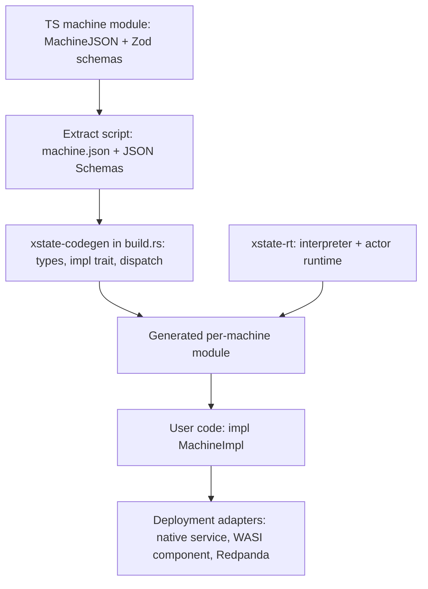

# xstate-rs

*Context for Claude Code. This repo is an independent Rust runtime that executes XState v6 machine definitions, with actions and guards written in Rust. It is not an official Stately package. Keep this file updated as decisions change.*

## Goal

Run full XState v6 statecharts and actor systems natively in Rust, with high performance and as close to a Redpanda broker as possible. Machines are authored in TypeScript (XState v6 alpha), exported as JSON, and executed by this runtime. Rust code supplies the implementations of named guards, actions, delays, and actors.

The two key requirements are semantic parity with XState v6 for the supported feature set, and a hot path with no JS engine, no string lookups, and no per-event allocation beyond what the semantics require.

## Background facts about XState v6

XState v6 is in alpha. **We pin `xstate@6.0.0-alpha.70`** (in `tools/differential/package.json`). APIs have changed between alphas; the package ships its docs in `node_modules/xstate/docs/*.md`, and those plus the runtime source (`dist/createActor-*.cjs.js`, `dist/xstate.cjs.js`) are the spec. The pages that matter most are serialization, transitions, how-xstate-runs-machines, delays, final-states, history-states, parallel-states and persistence.

Idiomatic v6 uses inline functions for transitions, guards, and actions, which serialize to `{"@code": "...", "@lang": "ts"}` (or `{"@expr": ...}`) and cannot run here. Machines that target this runtime must be written in the JSON-portable style: transitions as objects, with guards and actions referenced by name.

Verified against alpha.70:

- **Machine data format:** `machineToJSON(machine)` and `machineConfigToJSON(config)` produce `MachineJSON`. In JS, `machineFromJSON(json, sources)` revives it; that is our reference implementation for differential testing. (Older alphas called these `serializeMachine` / `createMachineFromConfig`.)
- **Transitions in JSON:** `{ target?, matches?, context?, actions?, guard?, reenter?, description?, meta?, input? }`, or an array of them (arrays are accepted by `machineFromJSON` only). String shorthand is rejected. `context` is a static shallow patch applied before `actions`. `matches` is a shallow pattern over the event payload, checked before the guard.
- **Guards in JSON:** `{ type, params? }`. A JSON-referenced guard receives the transition arguments first and `params` second. Built-ins: `@xstate.not` (`params.guard`) and `@xstate.stateIn` (`params.stateId`, with or without `#`). Root `guards: { name: { when: <guard> } }` defines named guards in JSON; JSON names win over provided sources.
- **Actions in JSON:** `@xstate.raise` (`event`, optional `id`, numeric `delay`), `@xstate.emit` (`event`), `@xstate.assign` (`context`, shallow merge), `@xstate.cancel` (`id`), `@xstate.log` (`args`). Any other `{ type, params }` is custom. Root `actions: { name: action | action[] }` defines named action lists in JSON. Names starting with `xstate.` / `@xstate.` are reserved.
- **Delays:** `after` keys are numbers (ms), named delays, or duration strings (`500ms`, `1.5s`, ISO 8601 such as `PT1M30S`). Root `delays: { name: number | string | { duration } }`.
- **Lifecycle events carry identity as payload** rather than in the type: `{ type: "xstate.done.state", stateId, output? }` and `{ type: "xstate.after", delay, stateId }` (`delay` is a number for numeric keys, the key string otherwise). `after` and `onDone` are sugar for transitions on these types with `matches` set. An unmatched done event bubbles like any other event.
- **`onDone` on states:** `machineToJSON` emits it, but `machineFromJSON` rejects it as an unknown key. We accept it and desugar it the way `createMachine` does (`xstate.done.state` with `matches: { stateId: <own id> }`).
- **Eventless transitions** use the `always` key.
- **Ids:** a state's id is its explicit `id`, else the key path joined by `.` and prefixed with the machine `id` if there is one (the root's id is the machine id, or `""`). `#id` targets match a whole id exactly.
- **Not representable in JSON yet:** state `input`, `enq.listen` / `enq.subscribeTo`, and `choice` functions. Reject these.
- **Schemas:** `schemas.context`, `schemas.events`, `input`, `output`, `emitted`, `children`, `schemas.actions`, `schemas.guards`. JSON `schemas` are descriptive only; runtime schemas are dropped by serialization, so they must be extracted at build time from the TS source.
- **Persistence:** v5 snapshots are not compatible with v6. We do not need byte-compatibility with JS snapshots unless decided otherwise.

## Architecture



Workspace crates (only `xstate-rt` exists so far):

- `xstate-rt`: the core. Parses `MachineJSON`, compiles it into an indexed state tree, runs the interpreter and (later) the actor runtime. Generic, with nothing machine-specific.
- `xstate-codegen`: build-time generator. Reads `machine.json` plus JSON Schemas and emits typed Rust (context, events, params, the implementation trait, and the `Machine` trait impl).
- `xstate-wasi`: a WASI component adapter exposing the runtime through WIT.
- `xstate-redpanda`: the co-located, partition-sharded service.

Other directories: `fixtures/` (shared differential fixtures), `tools/differential/` (the JS side of differential testing).

## Core runtime design (`xstate-rt`)

Module map: `load.rs` (validation and compilation), `machine.rs` (compiled arena), `interp.rs` (selection, microstep, macrostep, timers), `actor.rs` (public `Actor` API), `snapshot.rs` (persist/restore), `registry.rs` (Rust implementations), `event.rs`, `delay.rs`, `error.rs`.

### Compilation

The interpreter never sees names on the hot path. At load time, the runtime does the following:

- Reject any `@code` or `@expr` node anywhere in the definition, reporting the JSON path. Reject unknown keys like `machineFromJSON` does. Fail loudly on unsupported features (`invoke`, `onError` and non-empty `actors` until milestone 2; `timeout` / `onTimeout`, `choice`, `route`, state and transition `input`, non-root `context`) instead of silently ignoring them.
- Build a flat arena of state nodes indexed in document (pre-order) order. Index order then equals document order, so entry order is ascending index and exit order is descending index. Each node stores `end` (one past its last descendant), so descendant checks are a range check.
- Resolve every target to node indices. Support `sibling.path` (relative to the source's parent), `.child` (relative to the source), and `#id`. `\.` escapes a dot inside a key.
- Resolve every guard, action, and named delay reference to an index. Registry entries are factories that take the reference's `params` and return a bound closure, so params are deserialized once at compile time. Missing implementations and bad params are load errors. Named JSON guards and actions are expanded inline (with cycle detection).
- Intern every event descriptor. Dispatching an event costs one hash lookup of its type; per-state candidates are then found by binary search. Wildcard descriptors are kept separately, longest first.
- Preserve object key order from JSON (`serde_json` with `preserve_order`). Transition priority depends on it.

The registry exposes typed helpers: `guard_with::<P>(name, |args, p: &P| ...)`, `action_with::<P>`, `delay(name, |ctx, ev| ms)`, `delay_ms`.

### Events

User events are a generic `E: EventType` (`event_type()` is required; `field`, `to_json` and `from_json` default to serde), typically a generated serde enum with `#[serde(tag = "type")]`. `serde_json::Value` implements it for untyped use. Internally:

```rust
pub enum Ev<E> {
    Init,
    User(E),
    Internal { event_type: Cow<'static, str>, data: serde_json::Map<String, Value> },
}
```

A raised JSON event is deserialized into `E` when possible and falls back to `Internal`. Lifecycle events are `Internal` with a borrowed type, so they do not allocate the type string.

Event descriptor matching (verified): exact names, `prefix.*` (which also matches `prefix` itself), and `*`. Within a state, exact matches come first, then wildcards ordered by descriptor length, longest first.

### Interpreter

A port of XState's `macrostep` / `microstep`:

- Selection is XState's `transitionNode`: recurse into the active configuration; a node's own candidates are tried only if none of its active descendants selected a transition (for a parallel node, none of its regions). Final states are inert. Then conflicting transitions are removed (a descendant source preempts its ancestor when exit sets intersect).
- Transition domain: as XState's `getTransitionDomain`. Targetless transitions exit and enter nothing. If all effective targets are the source or its descendants, the domain is the source (with `reenter`) or the source narrowed past parallel states. Otherwise it is the least common ancestor, again narrowed past parallel states unless `reenter`, so a transition confined to one region never exits sibling regions. A non-reentering self-target on a compound state exits and re-enters its children (back to `initial`).
- Exit: record history (shallow means active children, deep means active atomic descendants), cancel the state's `after` timers, run exit actions, remove from the configuration. Delayed raises are not cancelled on exit.
- Then transition content: the `context` patch, then `actions`.
- Entry: compute the entry set (targets, initial descendants, all regions of parallel states, history defaults or recorded values, ancestors inside the domain), enter in document order, run entry actions, then schedule `after` timers. Entering a final state queues `xstate.done.state` for its compound parent with its `output`; completing parallel ancestors queue their own done events with an output object keyed by region. A final child of the root sets status `done` and the output (root `output` if declared, else the final state's `output`); then every active state's exit actions run and all timers are cleared. The configuration is kept so the final value remains visible.
- Macrostep: microstep for the external event, then loop: select eventless transitions; if none, take the next internal event. After an eventless microstep that changed nothing a guard could observe (configuration, history, context, timers), eventless transitions are not re-selected until another event is processed, as in XState. More than `max_iterations` (default 1000) microsteps is `RuntimeError::InfiniteLoop` and the actor goes to `error`.
- Actions run in order and take effect immediately. `@xstate.assign` and transition `context` patches shallow-merge through `serde_json::Value` (slow path).
- **Extension:** in XState, custom JSON actions are effects that receive only their params and run after the snapshot is computed. Here custom Rust actions run inline, in order, and can read and write the context (`ActionArgs::context_mut`, which marks the context as changed), emit, and raise. Differential fixtures only use custom actions that do nothing observable.

### Time and scheduling

The runtime never reads a clock or sleeps. The host drives time:

```rust
actor.send(event, now_ms);   // does not fire due timers; call advance first
actor.next_deadline();       // Option<u64>
actor.advance(now_ms);       // fires due timers in (due, seq) order
```

Timers come from `after` (identified by state and `after` entry, cancelled on exit) and from delayed `@xstate.raise` (by `id`, or by a per-actor sequence number when there is no id). Scheduling a timer whose key is already pending replaces it. While firing a timer, the actor's clock is its due time, so nested delays are deterministic (verified against XState's `SimulatedClock`). A fired timer's event is processed as an internal event. Numeric `after` keys are milliseconds; fractional values round up.

This keeps the core deterministic and portable to WASI and Wasm (`xstate-rt` builds for `wasm32-unknown-unknown`). Never call `std::time::Instant::now()`.

### Snapshots and persistence

`PersistedSnapshot<C>` (serde) holds the machine id and version, status, active configuration (state ids in document order), context, output, history values (by history state id), pending timers (key, due, order, delay, event as JSON), the timer counters, and the actor's clock. `value` holds XState's nested state value for display. Restoring maps ids back to indices, checks that the configuration is legal, rejects snapshots for another machine id or version, and runs no actions. Binary encodings (postcard, rkyv) need a non-self-describing replacement for the `serde_json::Value` fields; decide that in milestone 6.

### Actor runtime (milestone 2)

The design is single-threaded per shard, with no locks:

- `ActorLogic`-style trait: initial snapshot, transition, start, persist and restore.
- Mailbox (FIFO, one event at a time), system registry by `systemId`, parent and child links, `stop` cascading to children.
- Done and error propagation to the parent as `xstate.done.actor` and `xstate.error.actor` events (with `actorId` / `sessionId` payload, selected via `matches`, like the state events above). State-level `onError` catches `xstate.error.*`.
- Heterogeneous children stored as `Box<dyn AnyActor>`, with events crossing actor boundaries as `serde_json::Value` and converted at the receiver's mailbox. `schemas.children` drives typed `ActorRef<Child>` handles in generated code.
- Async invoked actors run on a local executor. Their results return as events.

## Codegen (milestone 3)

Every machine that targets Rust must provide Zod schemas, including `schemas.actions` and `schemas.guards` for params. The pipeline:

1. A TS extract script imports each machine module, which exports a `MachineJSON` definition and its Zod schemas. It converts schemas with Zod 4's JSON Schema converter and writes `machine.json` and the schema files.
2. A lint fails the build on any `@code` / `@expr` node, or on any referenced guard, action, actor, or delay without a schema entry.
3. `build.rs` generates types (via typify or a custom generator) and a per-machine trait, for example `CheckoutImpl` with methods like `guard_has_access(&self, args, &HasAccessParams) -> bool`. It also generates the registry wiring that maps names to typed trait calls, and an `EventType` impl whose `event_type` is a `match` (no serialization).

Mapping rules to enforce: `z.number()` is `f64` unless `.int()` (then `i64`); `x?: T` is `Option<T>`; discriminated unions become tagged enums. Reject intersections, generics, branded types, and untagged unions with a clear error.

## Deployment targets

- **WASI component:** a sync, host-driven core works on WASI 0.2 and 0.3. Export a WIT `actor` resource with `send`, `snapshot`, `persist`, `restore`, `next-deadline`, `advance`, and `take-emitted`, passing JSON strings. Target `wasm32-wasip2` with `wit-bindgen`. Adopt WASI 0.3 async for host-provided invoked actors once Rust guest tooling stabilizes.
- **Redpanda (performance target):** a native Rust service co-located on each broker node, not in-broker Data Transforms, which have no network or disk access and only support single-record transforms. Use follower fetching (`enable_rack_awareness`, per-node `rack`, `client.rack`) to read the local replica. Shard by partition with one thread per core. Keep actors in memory, back them with a compacted changelog topic per machine (binary snapshots via postcard or rkyv) plus a local embedded store, and use Kafka transactions to commit emitted events, changelog writes, and offsets atomically in batches. Persist timer firings through the changelog in the same transaction. Use `rdkafka`.

## Testing strategy

Differential testing against XState itself is the main correctness tool:

- `fixtures/<name>.json` holds `{ machine, steps }`, where each step is `{ at, send? }`: advance the clock to `at` (firing due timers), then send `send`.
- `tools/differential/generate.mjs` runs each fixture through `machineFromJSON` with stub guards (`yes`, `no`, `ctxEquals`, `ctxAtLeast`, `eventEquals`), a `noop` action and delays `short`/`long`, and writes `<name>.expected.json`: value, context, status, output and emitted events after start and after every step. Regenerate with `cd tools/differential && npm install && npm run generate` (or `node generate.mjs <name>`).
- `crates/xstate-rt/tests/differential.rs` replays the same fixtures with equivalent Rust stubs and diffs every record. Commit the expected files; they are the record of XState's behavior.
- `@xstate.emit` in entry/exit/transition actions is the way to observe action order in fixtures.

`crates/xstate-rt/tests/runtime.rs` covers what the JS side cannot: typed context and events, Rust actions with params, registry delays, load errors with paths, runaway loops, persist/restore round-trips including pending timers and history, `onDone`, `internalEvents`, and `stop`.

When v6 behavior is uncertain, add a fixture before choosing semantics.

## Milestones

1. ~~`xstate-rt` core: parsing, validation, compilation, interpreter, built-in actions, registry, host-driven timers, persist and restore, unit tests.~~ Done, with the differential harness (originally milestone 4) started early.
2. Actor runtime: invoke, spawn, system, done and error propagation.
3. Codegen pipeline and the TS extract script.
4. Differential test harness: extend fixtures to actors; add generated random event sequences.
5. WASI component adapter.
6. Redpanda co-located service with benchmarks.

## Conventions

- Prefer clarity over cleverness in the interpreter; correctness against XState comes first, then optimize with benchmarks. Known allocation hot spots to revisit: per-microstep `Vec<bool>` sets and transition lists, and `Ev::Internal` payload maps for lifecycle events.
- No `unsafe` in `xstate-rt`. No platform clocks, threads, or I/O in the core.
- Every unsupported v6 feature produces a clear error naming the feature and its JSON path.
- When v6 behavior is uncertain, write a differential test before choosing semantics, and record the decision in this file.
- `cargo fmt`, `cargo clippy --all-targets` clean, `cargo test` green before pushing.
