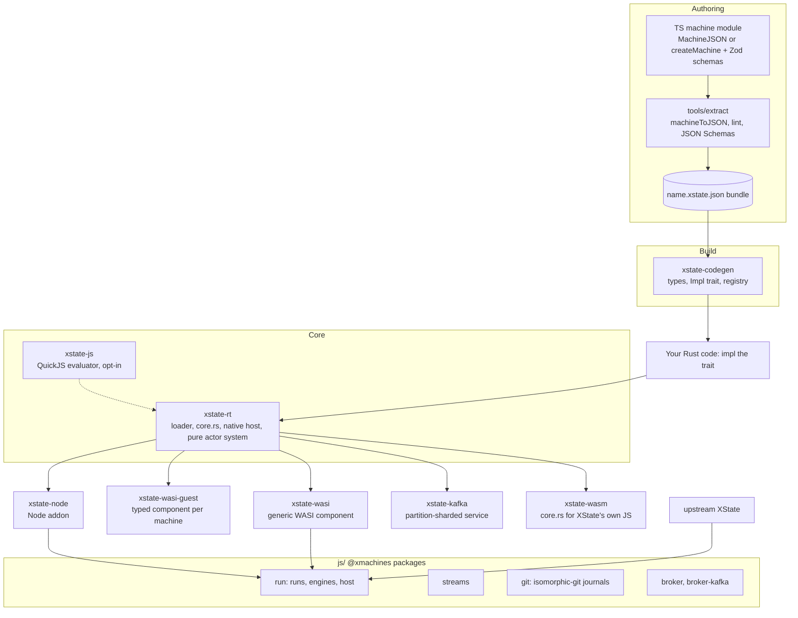
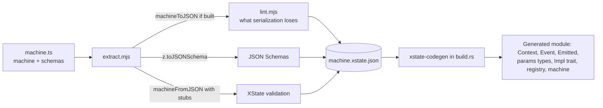
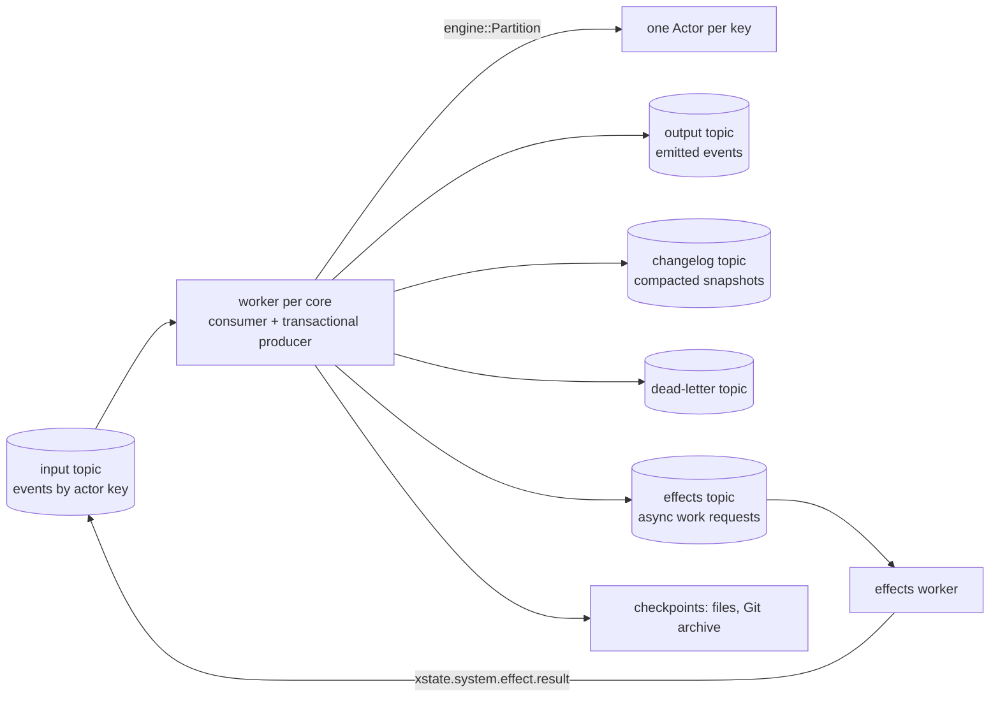

# xstate-rs: what is built and how it fits together

*An overview of the whole repository: the Rust runtime, the authoring pipeline, the deployment targets, the TypeScript packages, and the testing that holds them to XState's behavior. For individual decisions, see `CLAUDE.md`, the source of truth.*

## The idea in one paragraph

Machines are written in TypeScript against XState v6 (pinned to `6.0.0-alpha.70`), turned into XState's own JSON format (`MachineJSON`), and run by a Rust runtime that reproduces XState's semantics exactly. Rust (or JavaScript, opt-in) supplies the code a machine references: guards, actions, delays, computed values and child actors. The same runtime then runs in several places: inside a Rust program, as a WASI component, as a Node.js addon, and as a Kafka service next to the broker. A set of TypeScript packages implements the XMachines Run, Streams, Git and Broker RFCs, and can use either upstream XState or this runtime as its engine. Every one of these persists the same snapshot format (XState's `SystemSnapshot` JSON), so a running machine can move between them.

## The big picture

Three things connect everything in this picture:

- **One machine format.** XState's `MachineJSON` is the input everywhere, with code given as XState's own code nodes (`{"@code": ..., "@lang": ...}`).
- **One persisted state.** XState's `SystemSnapshot` JSON is what every engine writes and reads. A Kafka changelog record, a Git journal snapshot and a WASI `persist()` all hold the same data.
- **One semantics.** Every runtime is checked against XState's recorded behavior, and the Rust core runs XState's own test suite.

## The core runtime (`crates/xstate-rt`)

### Loading and compiling a machine

`Machine::from_json(definition, &registry)` validates the JSON as strictly as XState's `machineFromJSON`, rejecting unknown keys and unsupported features with their JSON path. It then compiles the definition so that the hot path never looks anything up by name:

- **States** go into a flat arena in document order, so entry order is ascending index and descendant checks are range checks.
- **Targets** (`sibling`, `.child`, `#id`) are resolved to node indices.
- **Implementations:** every guard, action, delay and code node is bound to its implementation once. Registry entries are factories that receive their `params` at load time.
- **Event descriptors** are interned: an event costs one hash lookup, then binary search per state, with wildcards kept separately.
- **Desugaring:** route states, choice states, `onDone` and `after` become ordinary transitions, as XState itself formats them.

The `Registry` is where the host supplies code. It covers guards, actions, delays, actor logic for `invoke` and `spawn`, Rust expressions, root-context expressions and evaluators for other languages. `Machine::references` lists everything a definition needs without loading it, which codegen, the WASI component and the Kafka binary use to wire implementations automatically.

### Running a machine: `core.rs` plus a host

> The internals are XState-true: `core.rs` is a port of the structural half of XState's `stateUtils.ts`.

Selection, conflict removal, transition domains, exit and entry sets, the microstep, and the macrostep loop live in `core.rs`. They are written against a `Host` trait, called at exactly the points XState does value-level work. Two hosts exist:

- **Native host (`interp.rs`):** values, effects, timers and context merges in Rust.
- **XState's own JS:** reached through `xstate-wasm` and a patch to XState's source. This is how XState's own test suite runs on the Rust core.

The native host mirrors XState's effect model. A transition's `context` patch and actions are resolved against the snapshot at the start of the microstep. `@xstate.raise` queues internally, delayed raises and cancels change logical timers, and emits, logs and custom actions become effects after the macrostep. A failed macrostep keeps the previous snapshot in `error` and discards the step's effects. Some configurations are illegal but reachable in XState; they behave as they do in XState.

### Actors and systems

The actor layer is a port of XState's *pure* system API (`initialSystemTransition`, `systemTransition`, `advanceSystemTime`), not a live runtime with threads:

- **`System` is a value.** Each call takes an event, a time or an effect result, and returns the external effects it produced. Actors are addressed by path (`root/child`) with incarnation counters, so stale references and late results are rejected.
- **Invoke and spawn:** `invoke` (with `onDone`, `onError`, `onSnapshot`, `timeout`) and `spawn` (from actions, transitions and the root `context`) create system entries. A `systemId` registry tracks them, and stopping cascades.
- **External effects** have ids `system:N` and stay pending until acknowledged or resolved. Async work (`@xstate.effect`) is the important case: the host does it and answers with `xstate.system.effect.result`.
- **`Actor`** is the convenience wrapper. It runs custom actions, collects the root's emits and logs, and fires timers one occurrence per step, like XState's live actor.

### Time

The runtime never reads a clock. The host passes `now` to `send` and `advance`, and asks `next_deadline()` when to come back. Timers live in the system, keyed like XState's, with the actor's clock set to the due time while a timer fires, so nested delays are deterministic. This is what makes the core portable to `wasm32` and what lets the JavaScript runs treat time as an input event.

### Persistence

`System::to_json` and `from_json` (`Actor::persist` / `restore`) read and write XState's `SystemSnapshot`. XState's own snapshots restore into an equal Rust system, which every system fixture checks. For hot paths there are serializer views that encode without building JSON values, and an opt-in compact form that leaves out what restore rebuilds. A `Migration` rewrites persisted snapshots for a newer machine version: state ids, history, timer events and a context patch.

## Code inside machines

XState's JSON format represents computed values as code nodes, and `machineFromJSON` hands each one to `sources.evaluators[lang]`. xstate-rs keeps that model exactly, with three ways to supply the code:

| Language | Who runs it | Where it is supplied |
|---|---|---|
| `rust` | A Rust function named by the node's source | `Registry::expr`, `Registry::context`, codegen's `expr_*` methods |
| `js`, `ts` | Embedded QuickJS (`crates/xstate-js`) | `Registry::evaluator("js", JsEvaluator::new())`, the Kafka binary's `js` feature |
| Any other | An evaluator you register, or the host | `Registry::evaluator`, `HostEvaluator` for WASI and Node |

Each evaluator receives XState's arguments: the source, the kind (`@code` or `@expr`), the slot (`guard`, `action`, `transitionContext`, `delay`, `output`, and so on) and the JSON path. It also receives XState's scope: `context`, `event`, `input`, `params`, `self`, `children`, and `enq` where XState provides it.

- **`enq`** gives code the same operations as XState's: `raise`, `emit`, `cancel`, `log`, `sendTo`, `stop`, `spawn`, and `enq(actions.name, params)` for registered actions.
- **Errors:** an error thrown anywhere fails the step, as an exception does in XState.
- **Transition functions:** a code node can be a whole transition (XState's `to` function), returning `{ target, context, reenter }` and enqueuing actions.

**Rust expressions** are the fast path: a code node costs about what any Rust closure costs.

**JavaScript (`xstate-js`)** lets machines authored with inline functions run unchanged. `machineToJSON` writes those functions as `ts` code nodes, the extract script strips their types, and QuickJS runs them the way XState's own test evaluators do. It is deterministic by default (`Math.random()` and the clock throw), memory- and time-limited per call, and costs about 3.4 µs per code node.

**Host evaluators** run code in another runtime through JSON text. The WASI component's `evaluate` import and the Node addon's `evaluate` callback work this way. The recorded `enq` calls are replayed in Rust, so `spawn` is not available there.

## Authoring pipeline

**Extract (`tools/extract`).** It loads a TypeScript module that exports a `machine` (JSON data, or a machine built with `setup()` / `createMachine()`) and its Zod `schemas`, then:

- converts the schemas to JSON Schema;
- strips types from `ts` code nodes and validates the definition with XState's own `machineFromJSON`;
- reports what serialization lost (`lint.mjs`), then writes a committed bundle that `--check` keeps in sync.

The loss report has two levels:

- **Errors** for invokes of inline actor logic, which `machineToJSON` drops entirely, and for JavaScript that reads names its module defined. It finds those with an acorn scope walk: a serialized function keeps only its text. Code reading `guards` or `delays` from its scope is an error too.
- **Warnings** for `setup()` implementations the host now has to supply.

**Codegen (`crates/xstate-codegen`).** Run from `build.rs`, it lints the bundle against the runtime's own loader and the schemas: references need schema entries, params and payloads must validate, and events must be declared. It then emits typed Rust: serde types for context, events, emitted events and params, an `<Id>Impl` trait with one method per guard, action, delay, actor, expression and evaluator, plus `registry()`, `machine()`, and typed handles for invoked children. `examples/checkout` shows the whole path, and `examples/checkout-component` compiles the same machine into a WASI component.

## Deployment targets

### WASI components (`crates/xstate-wasi`, `crates/xstate-wasi-guest`)

The generic component loads any `MachineJSON` at run time. Its `implementations` imports (`guard`, `action`, `delay`, `expr`, `context-expr`, `evaluate`) are wired to whatever the definition references. Start options supply child machines; any other `invoke.src` becomes async work the host completes through `resolve-effect`. The typed guest component runs one machine whose implementations are compiled in through the codegen trait, so it needs no host calls. Values cross as JSON text; `xstate-wasi-host` tests both from Wasmtime.

### Node addon (`crates/xstate-node`)

The same actor API as the WASI component, in camelCase, through napi-rs. Implementations are synchronous JavaScript callbacks, `evaluate` included. It is one of the engines behind `@xmachines/run`.

### Kafka service (`crates/xstate-kafka`)

A native service for any Kafka-API broker, meant to run on each broker node:

- **Engine.** `engine::Partition` is deterministic: records and a time go in, output and changelog records come out. It holds one `Actor` per key and a lazy timer heap, and makes one changelog record per changed actor per transaction.
- **Exactly once.** Each worker commits a batch's output, changelog records and input offsets in one Kafka transaction (EOS v2). Commits are pipelined with processing, and rebalances are cooperative, waiting for the previous owner's transaction before restoring.
- **Restore and checkpoints.** Partitions restore from the changelog. Pluggable checkpoint stores (local files, or a Git archive pushed to a remote) let a restart read only the changelog's tail, or restore a fresh node from the archive.
- **External work.** Pending async work is published to an effects topic in the same transaction. Whoever does it answers with XState's effect-result event on the input topic, and `effects::run` is a ready-made worker loop.
- **Formats.** Input events can be JSON, protobuf, MessagePack or Avro, chosen per record by `content-type`; the protobuf and Avro schemas are generated from the bundle. Snapshots are MessagePack by default, with protobuf, Avro or a compact form as options.
- **Operations.** Deduplication by a per-actor `(epoch, sequence)` mark, machine upgrades (older versions kept or migrated), backpressure that pauses partitions while busy, TLS and SASL, health and readiness probes, consumer lag, and Prometheus metrics.
- **Generic binary.** `xstate-kafka` runs a machine from a JSON config. With the `js` feature, which is on in the image, machines with JavaScript code nodes run without any Rust. A deploy stack (Redpanda, MQTT via Redpanda Connect) and a smoke test are in `deploy/`.

It is tested against librdkafka's in-process mock cluster. A run against a real broker is still to do.

## TypeScript packages (`js/`)

These implement the XMachines RFCs in pure JavaScript over Web Streams, with clients always injected (the fs, Kafka clients, addon, component):

- **`@xmachines/streams`:** framing (`ndjson`, `sse`, `json`), durable logs and replay, and write-through helpers that keep acknowledgements.
- **`@xmachines/run`:** a run is a deterministic execution with `in`, `out`, `err` and `snapshot` ports. Time is an input (`xmachines.time`) and a batch applies atomically. Run ids are Git commit hashes computed without Git. `host` adds the clock, timers, journaling and async work; `runner` opens runs by name.
- **Engines:** the run's engine is pluggable: upstream XState's pure system API, the native addon, or the WASI component. All three run JavaScript code nodes the same way, and a run's state moves between any pair of them.
- **`@xmachines/git`:** isomorphic-git durability. Machines are orphan branches, runs are forks whose commits are batches and snapshots, and refs only move forward. It includes a pure-JavaScript Git Smart HTTP server and push / pull replication, and works in browsers too (tested in Chromium with a Safari-like stream).
- **`@xmachines/broker`, `broker-kafka`, `broker-redpanda`:** record keys map to runs, partitions are leased with backpressure, and offsets are committed at least once. The Kafka transport uses an injected `@platformatic/kafka`.

## How the pieces connect

The same few contracts appear at every boundary, which is what lets parts be swapped:

| Contract | Defined by | Used by |
|---|---|---|
| `MachineJSON` with code nodes | XState | extract, codegen, every runtime, every engine |
| `SystemSnapshot` JSON | XState's pure system API | `Actor::persist`, Kafka changelog, Git journals, WASI, addon, JS runs |
| `xstate.system.effect.result` | XState | `Actor::resolve_effect`, Kafka effects topic, `resolved()` / `rejected()` in runs |
| Host-driven time | xstate-rt | `send` / `advance` / `next_deadline`, `xmachines.time` events |
| Evaluator arguments and scope | XState's `sources.evaluators` | `Registry::evaluator`, `xstate-js`, WIT `evaluate`, addon callback, `jsEvaluate()` |

A concrete path through the system: a module written with inline functions is extracted into a bundle. The Kafka binary loads it with QuickJS for its code nodes and processes events exactly once, publishing async work to the effects topic and snapshots to the changelog. The same bundle runs in a browser on `@xmachines/run` with upstream XState, journaled to Git. Snapshots from either side restore on the other, because both are XState's `SystemSnapshot`.

## How correctness is checked

> When XState's behavior is uncertain, a differential test comes before the choice.

- **XState's own test suite on the Rust core.** `tools/xstate-suite/run.sh` patches XState so its microstep and macrostep run in `core.rs` through `xstate-wasm`, then runs `packages/core/test`.
- **Differential fixtures.** `fixtures/*.json` (machines) and `fixtures/system/*.json` (actor systems) are run by XState, which records the expected traces, and replayed by Rust, which must match every record. That includes the full system snapshot, effects, and restoring XState's own snapshots.
- **Generated cases.** Seeded random machines and systems (`gen.mjs`, `fuzz.mjs`, `fuzz-system.mjs`) with committed corpora, plus `fuzz.sh` for fresh seeds.
- **Ported examples.** 42 fixtures from 31 of XState's own examples.
- **Code nodes.** Fixtures for every Rust-expression slot. The `probe` language checks each slot, path and kind XState passes to evaluators, and that a throw fails the step in every slot. Every Rust-expression fixture is also ported to JavaScript (`js_*`) and replayed through QuickJS.
- **Deployment tests.** Wasmtime drives both WASI components, the addon has its own Node tests, and the Kafka service is tested end to end on the mock cluster: restarts, rebalances, checkpoints, effects, Avro with a fake registry, and upgrades. The JavaScript packages have 47 tests, including engine parity and state moves.

## Performance at a glance

Measured on this 4-core cloud VM, release builds:

| What | Cost |
|---|---|
| A two-state toggle event | about 1.3 µs |
| An `after` timer firing | about 3.1 µs |
| Persist to MessagePack (small actor) | about 1.1 µs, 484 bytes |
| A JavaScript code node (QuickJS) | about 3.4 µs |
| Kafka engine, hot actors | about 740k records/s per core |
| Kafka engine, every record a different cold actor | about 275k records/s per core |
| Mock cluster, 4 workers end to end | about 410k–490k events/s |
| Memory per idle actor | about 1.5 KB |

A fitted cost model (`examples/cost_model.rs`) predicts a fixture's runtime from operation counts, with a median error of 6.5% under cross-validation.

## Known limits

- **`sendTo` / `spawn` as JSON actions** wait for XState's own JSON form; until then, code nodes and the host's typed child handles cover them.
- **`enq.listen` / `enq.subscribeTo`** are rejected, as XState's JSON cannot represent them yet.
- **Host evaluators cannot `spawn`**, since child ids come from Rust while the code runs. QuickJS and the XState engine can.
- **Serialization losses** (module closures, `setup()` functions, inline invoke logic) are XState's own; the extract lints report them at build time.
- **WASI 0.3 async** is not used yet; async work goes through pending effects instead.
- **No real-broker run yet:** the Kafka service has only been tested against librdkafka's mock cluster.

## Where things are

| Path | What it holds |
|---|---|
| `crates/xstate-rt` | Loader, `core.rs`, native host, actor system, persistence, registry |
| `crates/xstate-js` | QuickJS evaluator for JavaScript code nodes |
| `crates/xstate-codegen` | Typed Rust from bundles |
| `crates/xstate-wasm` | `core.rs` for XState's JavaScript (test suite bridge) |
| `crates/xstate-wasi`, `-guest`, `-host` | WASI components and their Wasmtime tests |
| `crates/xstate-node` | Node.js addon |
| `crates/xstate-kafka` | Kafka engine, service, binary, codecs, deploy stack |
| `tools/extract` | Bundle extraction and serialization lints |
| `tools/differential` | XState side of differential testing, fuzzers, JS ports |
| `tools/xstate-suite` | XState's test suite on the Rust core |
| `fixtures/` | Differential fixtures and recorded traces |
| `examples/` | The checkout machine through codegen and as a component |
| `js/packages/` | `@xmachines` streams, run, git, broker packages |
| `CLAUDE.md` | Every decision, with its reasoning and measurements |
